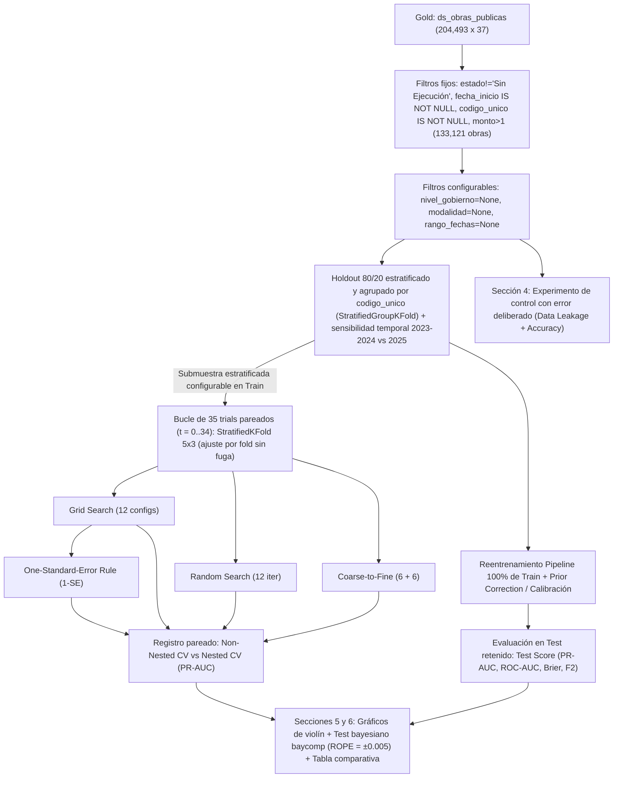

# POC de Clasificación Binaria y Estimación del Riesgo de Paralización de Obras Públicas (`mcies_ml_project`)

*   **Author:** ycalderonf@uni.pe
*   **Status:** Draft
*   **Date:** 2026-11-19

--------------------------------------------------------------------------------

## Overview

Este documento define el diseño técnico y experimental para desarrollar, en [mcies_ml_project](file:///c:/ws/formacion/uni-mia/mia-tesis-opa/mcies_ml_project), un modelo de clasificación binaria general y estimación probabilística del riesgo de paralización de obras públicas en el Perú a partir del dataset Gold [part-00000.parquet](file:///c:/ws/formacion/uni-mia/mia-tesis-opa/data/gold/ds_obras_publicas/part-00000.parquet) (`ds_obras_publicas`, `204,493` obras y `37` columnas).

El objetivo funcional es estimar la probabilidad condicional de que una obra pública sufra al menos una paralización durante su ciclo de ejecución (sin restringir por causal, modalidad ni nivel de gobierno por defecto):

$$p(\mathbf{x}_i) = \Pr(Y_i = 1 \mid \mathbf{X}_i = \mathbf{x}_i), \quad Y_i = \mathbb{I}(\texttt{flg\_existe\_paralizacion}_i = \texttt{True})$$

donde $\hat{p}_i \in [0, 1]$ representa el **riesgo de paralización de obra**, permitiendo jerarquizar proyectos preventivamente y derivar una clasificación dicotómica $\hat{Y}_i = \mathbb{I}(\hat{p}_i \ge c)$ bajo un umbral operativo $c$.

El diseño integra tres pilares:

1.  **Cumplimiento de [Primera Práctica Calificada 2026.pdf](file:///c:/ws/formacion/uni-mia/mia-tesis-opa/mcies_ml_project/Primera%20Pr%C3%A1ctica%20Calificada%202026.pdf)**:
    *   Notebook autocontenido y reproducible en Google Colab (`mcies_ml_project/P1-YanFrancoCalderonFelix.ipynb`) organizado en las 9 secciones evaluadas (20 puntos).
    *   Comparación experimental mediante **35 trials independientes** entre **validación cruzada anidada (`Nested CV`)** y **validación cruzada no anidada (`Non-Nested CV`)** usando `HistGradientBoostingClassifier` sobre cuatro métodos de búsqueda de hiperparámetros: `Grid Search`, `Random Search`, `Coarse-to-Fine Search` y `One-Standard-Error Rule`.
    *   Experimento de control con error deliberado (*data leakage* y métrica inadecuada), gráficos de violín de los 35 trials, tabla comparativa con test bayesiano correlacionado (`baycomp.two_on_single` con $\text{ROPE}$) y evaluación sobre conjunto de prueba temporal retenido (`Test Score`).
2.  **Alineamiento funcional con [main.typ](file:///c:/ws/formacion/uni-mia/mia-tesis-opa/tesis/plan/main.typ) e [Informe_Final_MIES.typ](file:///c:/ws/formacion/uni-mia/mia-tesis-opa/informe/Informe_Final_MIES.typ)**:
    *   **Filtros fijos obligatorios**: `estado_ejecucion != 'Sin Ejecución'`, `fecha_inicio_obra IS NOT NULL`, `codigo_unico IS NOT NULL` y monto válido `COALESCE(NULLIF(monto_aprobado_soles, 0), monto_aprobacion_et) > 1`. Sobre `ds_obras_publicas`, este universo reúne **`133,121` obras** (`12,224` paralizadas = **`9.18 %`** y `120,897` no paralizadas = **`90.82 %`**), entre `2001-07-13` y `2026-10-23`.
    *   **Filtros de dominio configurables**: parámetros explícitos en el notebook (`FILTRO_NIVEL_GOBIERNO = None`, `FILTRO_MODALIDAD_EJECUCION = None`, `FECHA_INICIO_MIN = None`, `FECHA_INICIO_MAX = None`) para ejecutar el modelo sobre el universo general por defecto o restringirlo sin modificar el código del pipeline a subcohortes específicas (por ejemplo, `['GOBIERNO NACIONAL']` y `['Contrata']` con `n = 7,925`).
3.  **Reutilización de la ingeniería de características de [proyecto_final_modelado.ipynb](file:///c:/ws/formacion/uni-mia/mia-tesis-opa/mead_project/proyecto_final_modelado.ipynb), [02_eda.ipynb](file:///c:/ws/formacion/uni-mia/mia-tesis-opa/notebooks/02_eda.ipynb) y [03_04_feature_engineering_target_woe_encoding_igeip_inco.ipynb](file:///c:/ws/formacion/uni-mia/mia-tesis-opa/notebooks/03_04_feature_engineering_target_woe_encoding_igeip_inco.ipynb)**:
    *   Exclusión estricta de variables posteriores al inicio o equivalentes al target (`causal_paralizacion_ultimo`, los 7 indicadores `ind_opa_*`, `estado_ejecucion` tras el filtro base, `fecha_finalizacion_real` y `fecha_foto`).
    *   Construcción causal (usando solo obras previas según `fecha_inicio_obra`) de `tasa_historica_movil_entidad` y `n_obras_previas_entidad`, combinada con transformaciones ajustadas exclusivamente dentro de cada pliegue de entrenamiento (`WinsorLogTransformer`, `BayesianTargetEncoder`, `WOEEncoder`, `OneHotEncoder` y `StandardScaler`).

--------------------------------------------------------------------------------

## The Problem

1.  **Sesgo optimista al seleccionar hiperparámetros con validación cruzada no anidada**:
    Cuando se utiliza el mismo esquema de validación cruzada tanto para elegir hiperparámetros (`best_score_` de `GridSearchCV` / `RandomizedSearchCV`) como para estimar el error de generalización, la operación $\max$ sobre múltiples configuraciones selecciona hiperparámetros que sobreajustaron el ruido particular de los pliegues de validación (Cawley & Talbot, 2010). En un problema desbalanceado (`9.18 %` de paralizaciones) con predictores de alta cardinalidad (`2,345` entidades, `1,734` distritos, `142` subtipos nivel 3), un árbol de boosting profundo o con poca regularización obtiene puntuaciones no anidadas artificialmente altas respecto a su rendimiento real en datos nuevos.
2.  **Incompatibilidad entre `TimeSeriesSplit` determinista y el análisis de 35 trials independientes**:
    En el proyecto previo ([proyecto_final_modelado.ipynb](file:///c:/ws/formacion/uni-mia/mia-tesis-opa/mead_project/proyecto_final_modelado.ipynb)) se utilizó `TimeSeriesSplit(n_splits=5)` externo y `TimeSeriesSplit(n_splits=3)` interno. Debido a que `TimeSeriesSplit` no tiene componente aleatorio, repetir 35 trials de métodos deterministas como `Grid Search` o `One-Standard-Error` produce **35 valores idénticos (`std = 0`)**, colapsando los gráficos de violín (Sección 5) e invalidando el cálculo de incertidumbre pareada del test bayesiano correlacionado (`baycomp.two_on_single`, Sección 6). Se requiere combinar una partición temporal retenida para `Test` (`fecha_inicio_obra`) con repeticiones controladas de `StratifiedKFold` sobre `Train` para los 35 trials.
3.  **Problemas estructurales del dataset que comprometen una validación ingenua**:
    *   **Desbalance de clases (`9.18 %` positivos vs `90.82 %` negativos)**: invalida métricas como *Accuracy* (un clasificador constante `0` logra `90.82 %` con `Recall = 0`).
    *   **Valores faltantes estructurales**: `ruc_1` y `monto_contrato_soles_eje` tienen `46.13 %` de nulos (obras por *Administración directa* y *Núcleo ejecutor* sin contratista externo); `ruc_2` (`82.24 %`) y `monto_contrato_soles_sup` (`91.83 %`) faltan cuando no existe contrato de supervisión separado; `tipo_formato` presenta `16.41 %` de nulos.
    *   **Alta colinealidad entre variables presupuestales**: `monto_aprobado_soles`, `monto_aprobacion_et` y `monto_contrato_soles_eje` guardan correlación elevada en escala logarítmica.
    *   **Dependencia institucional y deriva temporal**: múltiples obras comparten `codigo_entidad` o `codigo_unico`, y la proporción base de paralización cambia entre cohortes anuales de inicio y según los criterios censurados en la cola temporal reciente.

--------------------------------------------------------------------------------

## Goals

*   **G1 — Cohorte general configurable**: Construir el conjunto analítico leyendo `ds_obras_publicas`, aplicando obligatoriamente los 4 filtros fijos (`133,121` obras, `9.18 %` positivas) y permitiendo activar por parámetros de configuración filtros opcionales por `nivel_gobierno`, `modalidad_ejecucion_obra`, rango de `fecha_inicio_obra` y tamaño de muestra para el benchmark (`N_MUESTRA_TRAIN_BENCHMARK`).
*   **G2 — Pipeline de características libre de fuga de información**: Integrar exclusión explícita de columnas post-evento, limpieza monetaria heredada (`monto_aprobado_soles == 0` → `monto_aprobacion_et`, descartar `<= 1`), variables históricas causales por entidad y codificadores ajustados únicamente sobre entrenamiento dentro de `Pipeline` (`WinsorLogTransformer`, `BayesianTargetEncoder`, `WOEEncoder`, `OneHotEncoder`, `StandardScaler`).
*   **G3 — Comparación de 35 trials entre Nested CV y Non-Nested CV**: Ejecutar 35 trials independientes (`seed = 0..34`) usando `HistGradientBoostingClassifier` para `Grid Search`, `Random Search`, `Coarse-to-Fine Search` y `One-Standard-Error Rule`, reportando media y desviación estándar en `PR-AUC` (`average_precision`).
*   **G4 — Experimento de control con error deliberado (Sección 4)**: Mostrar empíricamente la distorsión provocada por (a) *data leakage* (ajustar encoders supervisados y estadísticas históricas antes del split y/o incluir proxies posteriores) y (b) evaluar con *Accuracy* en presencia del desbalance `9.18 %`.
*   **G5 — Visualización, test bayesiano y estimación de riesgo en `Test` (Secciones 5, 6 y 7)**: Generar gráficos de violín (`seaborn.violinplot`) de los 35 trials, aplicar el test bayesiano correlacionado (`baycomp.two_on_single` con $\text{ROPE}$), completar la tabla comparativa obligatoria de 7 columnas de evaluación y medir en el conjunto de prueba temporal tanto discriminación (`PR-AUC`, `ROC-AUC`) como calibración de probabilidad de riesgo (`Brier Score`, curva de calibración y $F_2$).
*   **G6 — Reproducibilidad en Google Colab y documentación completa (Secciones 1, 8 y 9)**: Producir el entregable `mcies_ml_project/P1-YanFrancoCalderonFelix.ipynb` ejecutable de inicio a fin sin intervención manual, incluyendo documentación explícita del uso de IA generativa con un caso verificado/corregido manualmente y síntesis de errores y aprendizajes.

--------------------------------------------------------------------------------

## Non-Goals

*   **NG1**: No se restringe la variable objetivo a una causal específica (como incumplimiento contractual); en este POC el target modela cualquier evento de paralización (`flg_existe_paralizacion`).
*   **NG2**: No se incorporan fuentes externas ausentes en `ds_obras_publicas` (`INCO`, `IGEIP`, `marco`), dejando su integración para fases posteriores de Silver/Gold.
*   **NG3**: No se implementan modelos de supervivencia en tiempo continuo (Cox, Fine-Gray) ni múltiples familias de clasificadores dentro del bucle de 35 trials; la comparación de estrategias de búsqueda se fija sobre `HistGradientBoostingClassifier` para garantizar tiempos viables en Google Colab.

--------------------------------------------------------------------------------

## Critical User Journeys (CUJs)

### CUJ 1: Ejecución completa del notebook en Google Colab o entorno local (`P1-YanFrancoCalderonFelix.ipynb`)

*   **Given**: El archivo `mcies_ml_project/P1-YanFrancoCalderonFelix.ipynb` y su dataset compacto preparado para carga directa (o lectura desde `data/gold/ds_obras_publicas/part-00000.parquet` en local).
*   **When**: Se ejecuta *"Run all"* sin intervención manual ni edición de rutas.
*   **Then**: Todas las celdas se completan sin errores, generando la evidencia empírica de problemas del dataset, las tablas y gráficos de violín de los 35 trials (Nested vs Non-Nested), el experimento de error deliberado, el ranking gráfico y bayesiano (`baycomp`), la tabla comparativa completa y el análisis de calibración del riesgo de paralización $\hat{p}_i$ sobre `Test`.

### CUJ 2: Reconfiguración de filtros de dominio sin modificar el pipeline

*   **Given**: Un investigador que desea evaluar una subcohorte particular (por ejemplo, `modalidad_ejecucion_obra = ['Contrata']` y `nivel_gobierno = ['GOBIERNO NACIONAL']`) en lugar de las `133,121` obras generales.
*   **When**: Cambia las variables de configuración al inicio del notebook (`FILTRO_NIVEL_GOBIERNO`, `FILTRO_MODALIDAD_EJECUCION`, `FECHA_INICIO_MIN`) manteniendo inalterados los 4 filtros fijos.
*   **Then**: El flujo de limpieza, codificación adaptativa, validación y gráficos recalcula resultados sobre la nueva cohorte sin fallos de esquema o cardinalidad.

### CUJ 3: Cuantificación del sesgo optimista y contraste bayesiano de métodos de búsqueda

*   **Given**: Las 35 repeticiones pareadas de `Non-Nested CV` y `Nested CV` para `Grid Search`, `Random Search`, `Coarse-to-Fine Search` y `One-Standard-Error Rule`.
*   **When**: Se ejecutan las comparaciones visuales (violines) y estadísticas (`baycomp.two_on_single` con $\text{ROPE}$), además del contraste contra `Test Score` y el experimento con error deliberado.
*   **Then**: Se identifica qué estrategia ofrece mejor equilibrio entre desempeño fuera de muestra, estabilidad (menor varianza entre trials), control de sesgo optimista y costo computacional para una eventual puesta en producción.

--------------------------------------------------------------------------------

## Technical Plan (Architecture)

### 1. Flujo arquitectónico de extremo a extremo

El experimento completo se encapsula en [P1-YanFrancoCalderonFelix.ipynb](file:///c:/ws/formacion/uni-mia/mia-tesis-opa/mcies_ml_project/P1-YanFrancoCalderonFelix.ipynb) para ejecutarse de inicio a fin tanto en entorno local como en Google Colab sin intervención manual. Para garantizar la portabilidad en Colab, el repositorio incluirá un extracto compacto de las columnas requeridas de `ds_obras_publicas` en `mcies_ml_project/data/ds_obras_publicas_poc.parquet` (respaldado por lectura directa desde `../data/gold/ds_obras_publicas/part-00000.parquet` en local o descarga automática desde URL/repositorio configurado si faltara en Colab).

---

### 2. Reglas de selección de cohorte, exclusión de fuga y variables de entrada

#### A. Filtros fijos y configurables

| Tipo | Regla aplicada sobre `ds_obras_publicas` | Efecto sobre el universo |
|---|---|---|
| Fijo 1 | `estado_ejecucion != 'Sin Ejecución'` | Excluye obras sin inicio físico efectivo |
| Fijo 2 | `fecha_inicio_obra IS NOT NULL` | Excluye obras sin fecha de inicio para ordenamiento temporal |
| Fijo 3 | `codigo_unico IS NOT NULL` | Excluye obras sin proyecto de inversión asociado |
| Fijo 4 | `monto_aprobado_soles = COALESCE(NULLIF(monto_aprobado_soles, 0), monto_aprobacion_et)` y filtro `> 1` | Corrige ceros heredados con ET y descarta valores inválidos (`n = 133,121`; `12,224` positivas = `9.18 %`) |
| Configurable 1 | `FILTRO_NIVEL_GOBIERNO: list[str] \| None = None` | `None` incluye Nacional, Regional y Local; configurable a subconjuntos |
| Configurable 2 | `FILTRO_MODALIDAD_EJECUCION: list[str] \| None = None` | `None` incluye Contrata, Administración Directa, Núcleo Ejecutor, etc. |
| Configurable 3 | `FECHA_INICIO_MIN / FECHA_INICIO_MAX: str \| None = None` | Permite acotar cohortes temporales específicas |
| Configurable 4 | `N_MUESTRA_TRAIN_BENCHMARK: int \| None = 8_000` | Tamaño de muestra estratificada sobre `Train` para los 35 trials (escalable a `None` para usar todo `Train`) |

#### B. Exclusión obligatoria de variables por fuga de información (*data leakage*) y artefactos temporales

Se excluyen explícitamente como predictores todas las columnas generadas durante o después del cierre, las redundantes por colinealidad extrema y las variables temporales no estacionarias:

*   `flg_existe_paralizacion`: variable objetivo binaria ($Y \in \{0, 1\}$).
*   `ind_opa_contractual`, `ind_opa_financiero`, `ind_opa_operativo`, `ind_opa_externo`, `ind_opa_tecnico`, `ind_opa_gobernanza`, `ind_opa_no_clasificado`: su suma $> 0$ reconstruye exactamente $Y$.
*   `causal_paralizacion_ultimo`: solo existe cuando $Y = 1$.
*   `estado_ejecucion`: se utiliza únicamente en el Filtro Fijo 1 (`!= 'Sin Ejecución'`) y se elimina antes de armar $\mathbf{X}$, pues incluye la categoría `'Paralizada'`.
*   `fecha_finalizacion_real` y `fecha_foto`: atributos de cierre o fecha de extracción de la foto.
*   `anio_inicio` (derivada): se excluye como predictor porque en `ds_obras_publicas` las tasas de paralización dependen artificialmente de la ventana de observación de las fotos (`3.73 %–5.24 %` en `2014–2020`, `24.39 %` en `2024`, `4.50 %` en `2026`); incluir el año memorizaría el truncamiento izquierdo y la censura derecha en lugar de patrones de riesgo estructurales. Se retienen únicamente `mes_inicio_sin` y `mes_inicio_cos` estacionarios.
*   `monto_aprobacion_et` en bruto: presenta correlación $\text{corr}(\ln(1+\text{monto\_limpio}), \ln(1+\text{monto\_aprobacion\_et})) = 0.9999$; se reemplaza por `log1p(monto_aprobado_soles)` más `ratio_aprobado_et`.
*   `codigo_infobras` y `codigo_unico`: `codigo_infobras` se usa solo como clave de auditoría y `codigo_unico` como grupo de aislamiento en el holdout (`StratifiedGroupKFold`), nunca como variables del estimador.

#### C. Ingeniería de características pre-inicio (100 % sin fuga por pliegue)

Todas las transformaciones con parámetros estimados se ajustan únicamente sobre el subconjunto de entrenamiento de cada pliegue (`X_fit, y_fit`) generando una matriz densa `float32` (`sparse_output=False`) para `HistGradientBoostingClassifier`. En las variables categóricas de media y alta cardinalidad se utiliza **cross-fitting interno de 5 pliegues** (*out-of-fold* dentro de `fit_transform`) para evitar el sobreajuste clásico del *in-fold target encoding* en modelos basados en árboles:

| Grupo                                             | Transformador                                                                                 | Variables                                                                                                                                                                     | Lógica y justificación                                                                                                                                                                                                                                                                                                                                                                                                           |
| ------------------------------------------------- | --------------------------------------------------------------------------------------------- | ----------------------------------------------------------------------------------------------------------------------------------------------------------------------------- | -------------------------------------------------------------------------------------------------------------------------------------------------------------------------------------------------------------------------------------------------------------------------------------------------------------------------------------------------------------------------------------------------- |
| **Historial institucional causal**                | `CausalEntityHistoryEncoder` (`smoothing=20.0`, `lag_days=180`)                               | A partir de `codigo_entidad` y `fecha_inicio_obra` → `tasa_historica_movil_entidad`, `log1p_n_obras_previas_entidad`                                                          | En `fit(X_tr, y_tr)` indexa por `codigo_entidad` las obras de entrenamiento ordenadas por fecha; para cualquier registro $(e_i, t_{0i})$ calcula por búsqueda binaria la tasa suavizada $(s_{e, \le t_{0i}-180} + \alpha \hat{\pi}) / (n_{e, \le t_{0i}-180} + \alpha)$ usando solo obras iniciadas al menos `180` días antes de $t_{0i}$, evitando fuga entre pliegues de validación cruzada y hacia el pasado. |
| **Montos asimétricos**                            | `WinsorLogTransformer` (`upper_quantile=0.99`) + `StandardScaler`                             | `monto_aprobado_soles`                                                                                                                                                        | Recorta atípicos superiores al percentil 99 del pliegue y aplica $\ln(1 + x)$ para estabilizar la escala. Excluye `monto_aprobacion_et` en bruto por colinealidad `0.9999`.                                                                                                                                                                                                                          |
| **Derivadas pre-inicio y banderas estructurales** | Transformación determinista fila a fila (`PreInicioFeatureBuilder`)                           | `ratio_aprobado_et`, `ratio_contrato_aprobado`, `plazo_aprobacion_a_inicio_dias`, `flg_et_posterior_inicio`, `n_obras_relacionadas_proyecto`, `flg_tiene_contratista_eje`, `flg_tiene_supervision`, `mes_inicio_sin`, `mes_inicio_cos` | `HistGradientBoostingClassifier` maneja `NaN` de forma nativa; por ello, `ratio_contrato_aprobado` (`monto_contrato_soles_eje / monto_aprobado_soles`) conserva `NaN` en obras sin contratista acompañado de `flg_tiene_contratista_eje` (`ruc_1 IS NOT NULL`) y `flg_tiene_supervision` (`ruc_2 IS NOT NULL`), capturando el faltante estructural sin imputación artificial. El plazo de expediente se recorta a $\ge 0$ días marcando inconsistencias con `flg_et_posterior_inicio`. |
| **Categóricas de baja cardinalidad**              | `SimpleImputer('most_frequent')` + `OneHotEncoder(min_frequency=20, sparse_output=False)`     | `nivel_gobierno`, `modalidad_ejecucion_obra`, `naturaleza_obra`, `tipo_formato`, `tipo_obra_nivel_1`                                                                          | Despliega variables nominales de hasta ~16 niveles agrupando categorías infrecuentes (`< 20`).                                                                                                                                                                                                                                                                                                       |
| **Categóricas de cardinalidad media**             | `TargetEncoder(cv=5, smooth=20.0, target_type="binary")` de `scikit-learn`                    | `tipo_obra_nivel_2`, `tipo_obra_nivel_3`, `departamento`, `provincia`                                                                                                         | Utiliza *cross-fitting* interno de 5 pliegues en `fit_transform` sobre entrenamiento para que ninguna observación reciba codificación calculada con su propia etiqueta.                                                                                                                                                                                                                               |
| **Categóricas de alta cardinalidad**              | `WOEEncoderOOF(cv=5, smoothing=20.0, eps=0.5)`                                                | `codigo_entidad`, `sector_entidad`, `distrito`                                                                                                                                | Calcula *Weight of Evidence* mediante *cross-fitting* interno de 5 pliegues en `fit_transform` y guarda el diccionario global del entrenamiento para `transform`, reportando *Information Value* ($\text{IV}$) en el EDA.                                                                                                                                                                           |

---

### 3. Protocolo experimental de 35 trials (`Nested CV` vs `Non-Nested CV`)

#### A. Partición `Train`/`Test` y esquema pareado por trial

1.  **Holdout principal `80 %` / `20 %` estratificado y agrupado por proyecto (`StratifiedGroupKFold`)**: un split temporal ingenuo sobre `2001–2026` (`70 %` antiguo hasta `2022-02-11` vs `30 %` posterior) produce un salto de prevalencia de `4.94 %` en `Train` a `19.08 %` en `Test`, haciendo incomparables `PR-AUC` y `Brier Score` con los pliegues de CV. Por ello, la partición principal divide las `133,121` obras mediante `StratifiedGroupKFold(n_splits=5)` agrupando por `codigo_unico` (tomando el pliegue `0` como `df_test` retenido de `~26,624` obras y los 4 restantes como `df_train` de `~106,497` obras): esto garantiza **prevalencia idéntica (`~9.18 %`)** entre CV y `Test`, **cero fuga** entre obras pertenecientes al mismo proyecto de inversión, y validación directa sobre el conjunto de prueba. Complementariamente, en la Sección 6/7 se incluye un **análisis de sensibilidad temporal prospectivo** dentro de la ventana plenamente observada por las fotos (`Train: cohortes 2023–2024` vs `Test: cohorte 2025`).
2.  **Submuestra estratificada configurable y optimización computacional por pliegue**: sobre `df_train`, si `N_MUESTRA_TRAIN_BENCHMARK` es entero (por defecto `8_000`), se extrae una submuestra estratificada reproducible (`df_bench`, `random_state=42`) para ejecutar los 35 trials dentro de un tiempo total viable en Google Colab (< 5 min). Dado que los hiperparámetros sintonizados pertenecen exclusivamente a `HistGradientBoostingClassifier`, dentro de cada pliegue `(train_idx, val_idx)` se ajusta y aplica el transformador de características **una sola vez** sobre `(X[train_idx], y[train_idx])` antes de evaluar los candidatos —matemáticamente equivalente al `Pipeline` y `~36×` más rápido—; al evaluar en `df_test` y en los análisis finales se utiliza un `Pipeline` completo ajustado sobre el **100 % de `df_train`**.
3.  **Métrica de optimización y comparación**: `PR-AUC` (`average_precision_score`). Frente al desbalance `9.18 %`, `PR-AUC` concentra su evaluación en el ordenamiento de la clase positiva y no se diluye por los verdaderos negativos como `Accuracy`.
4.  **Generación de 35 trials independientes y pareados**: para cada trial $t \in \{0, 1, \dots, 34\}$ se definen los mismos divisores entre los cuatro métodos:
    *   Bucle externo: `StratifiedKFold(n_splits=5, shuffle=True, random_state=100 + t)`
    *   Bucle interno: `StratifiedKFold(n_splits=3, shuffle=True, random_state=500 + t)`
    *   Estimador base: `HistGradientBoostingClassifier(class_weight="balanced", max_iter=60, early_stopping=True, validation_fraction=0.1, n_iter_no_change=10, random_state=42)`.

#### B. Definición de los cuatro métodos de búsqueda (presupuesto homogéneo de 12 configuraciones)

Para garantizar equidad computacional entre estrategias, cada búsqueda evalúa exactamente `12` configuraciones por ajuste:

| Método | Espacio y algoritmo de búsqueda | Medición `Non-Nested CV` (trial $t$) | Medición `Nested CV` (trial $t$) |
|---|---|---|---|
| **1. Grid Search** | Malla cartesiana fija de $3 \times 2 \times 2 = 12$ puntos: `max_leaf_nodes` $\in \{15, 31, 63\}$, `learning_rate` $\in \{0.04, 0.12\}$, `l2_regularization` $\in \{0.1, 10.0\}$. | Ejecuta la búsqueda de 12 puntos usando directamente `outer_cv(t)` (`5` pliegues) y registra `max_k mean_test_score(k)`, midiendo la puntuación optimista seleccionada sobre los mismos datos de validación. | Para cada pliegue externo $j \in \{1..5\}$, evalúa las 12 configs en `inner_cv` sobre $X_{\text{tr}}^{(j)}$, selecciona $\hat{\theta}_j^*$, ajusta en $X_{\text{tr}}^{(j)}$ y evalúa en $X_{\text{val}}^{(j)}$; registra la media de los 5 scores externos y conserva los 5 scores por fold. |
| **2. Random Search** | Muestreo aleatorio de `n_iter=12` puntos (semilla `1000 + t` por trial) en el mismo dominio: `max_leaf_nodes` $\in [10, 80]$, `learning_rate` $\sim \text{LogUniform}(0.02, 0.25)$, `l2_regularization` $\sim \text{LogUniform}(0.01, 20.0)$, `min_samples_leaf` $\in \{15, 25, 45\}$. | Mejor score medio de las 12 configuraciones muestreadas evaluadas directamente sobre los 5 folds de `outer_cv(t)`. | Evalúa 12 muestras aleatorias (semilla `1000 + t*10 + j`) dentro de `inner_cv` en cada $X_{\text{tr}}^{(j)}$, ajusta el mejor en $X_{\text{tr}}^{(j)}$ y evalúa en $X_{\text{val}}^{(j)}$. |
| **3. Coarse-to-Fine Search** | **Etapa 1 (Coarse, 6 puntos)**: `max_leaf_nodes` $\in \{15, 31, 63\}$, `learning_rate` $\in \{0.04, 0.12\}$, `l2_regularization = 1.0`. **Etapa 2 (Fine, 6 puntos)**: 6 configuraciones refinadas en la vecindad local de $\hat{\theta}_1$ ($\text{leaf} \pm 30\%$, $\text{lr} \times \{0.7, 1.0, 1.3\}$, $l_2 \in \{0.1, 5.0, 15.0\}$, `min_samples_leaf` $\in \{20, 40\}$). | Mejor score medio global entre Etapa 1 y Etapa 2 evaluado directamente sobre `outer_cv(t)`. | Ejecuta Etapa 1 + Etapa 2 estrictamente dentro de $X_{\text{tr}}^{(j)}$ usando `inner_cv(t)`, selecciona $\hat{\theta}_2^*$, reentrena en $X_{\text{tr}}^{(j)}$ y evalúa en $X_{\text{val}}^{(j)}$. |
| **4. One-Standard-Error Rule** | Opera sobre los resultados por pliegue de `Grid Search`: calcula $\mu^* = \max_k \bar{s}_k$ y $\text{SE}^* = \sigma(s_{k^*}) / \sqrt{K}$. Filtra $\bar{s}_k \ge \mu^* - \text{SE}^*$ y elige el menos complejo por orden lexicográfico `(max_leaf_nodes ASC, -l2_regularization ASC, learning_rate ASC)`. | Aplica la regla 1-SE sobre los 12 candidatos evaluados en `outer_cv(t)` y reporta $\bar{s}_{\text{1SE}}$ sobre `outer_cv(t)`. | Dentro de cada pliegue externo $j$, aplica la regla 1-SE solo sobre los 3 folds internos de `inner_cv(t)`, reentrena el modelo parsimonioso elegido en $X_{\text{tr}}^{(j)}$ y evalúa en $X_{\text{val}}^{(j)}$. |

---

### 4. Estimación probabilística del riesgo de paralización, calibración y evaluación en `Test`

Dado que `HistGradientBoostingClassifier(class_weight="balanced")` pondera la pérdida por $w_c = n / (2 n_c)$, la probabilidad cruda $\hat{p}^{(w)}(\mathbf{x})$ sobrestima el riesgo base (`9.18 %`). Antes de reportar $\hat{p}_i$ como **riesgo de paralización de obra** y evaluar `Brier Score` sobre `df_test`:

1.  Se aplica la **corrección analítica de prior** (`ec-correccion-prior` de [main.typ](file:///c:/ws/formacion/uni-mia/mia-tesis-opa/tesis/plan/main.typ)):

    $$\hat{p}_{\text{corr}}(\mathbf{x}) = \frac{w_0 \, \hat{p}^{(w)}(\mathbf{x})}{w_0 \, \hat{p}^{(w)}(\mathbf{x}) + w_1 \, (1 - \hat{p}^{(w)}(\mathbf{x}))}$$

2.  Se entrena el `Pipeline` ganador de cada una de las 4 estrategias sobre el **100 % de `df_train`** y se evalúa en **`df_test`** (`~26,624` obras nunca vistas):
    *   **Métrica principal (`Test Score`)**: `PR-AUC`, acompañada de `ROC-AUC` y Gini.
    *   **Calibración de riesgo**: `Brier Score` antes y después de `prior correction` / calibración isotónica, junto con curva de confiabilidad (*reliability diagram*).
    *   **Decisión binaria operativa**: Precisión, `Recall` y $F_2$ al umbral $c^*$ optimizado sobre validación interna.
    *   **Sensibilidad temporal prospectiva**: evaluación adicional entrenando exclusivamente con obras iniciadas en `2023–2024` y validando sobre la cohorte `2025`.

---

### 5. Diseño del Experimento de Control (Sección 4 — Error Deliberado)

Se implementan y cuantifican errores metodológicos deliberados contrastados contra el flujo limpio:

1.  **Error A — *Data Leakage* por codificación pre-split, historia con información futura y proxy post-evento**:
    *   *Subcaso A1 (Fuga de codificación)*: ajustar `BayesianTargetEncoder`, `WOEEncoder` y estadísticas históricas sobre el 100 % de `df_bench` (incluyendo etiquetas futuras) antes de dividir `Train`/`Val`/`Test`.
    *   *Subcaso A2 (Fuga temporal/operativa)*: incorporar columnas excluidas por el dominio (`estado_ejecucion`, que incluye `'Paralizada'`, y `anio_inicio`, que filtra la ventana de las fotos) evaluando luego en un esquema temporal estricto (`2023–2024` vs `2025`) donde esas variables fallan o distorsionan la priorización real.
2.  **Error B — Métrica inadecuada (*Accuracy* sin ponderación sobre desbalance `9.18 %`)**:
    *   Un modelo entrenado sin ponderación y evaluado por *Accuracy* al umbral `0.50` alcanza `~91 %` de exactitud ocultando una tasa de detección (`Recall`) muy baja de obras realmente paralizadas.

---

### 6. Comparación estadística, gráficos de violín y tabla comparativa (Secciones 5 y 6)

1.  **Gráficos de violín (Sección 5)**: con `seaborn.violinplot` (incluyendo cuartiles internos y dispersión de puntos), se comparan los 35 valores de `Non-Nested CV` vs `Nested CV` para los 4 métodos, más un gráfico de las diferencias pareadas $\delta_t = \text{Non-Nested}_t - \text{Nested}_t$, analizando dispersión, estabilidad vs variabilidad y sesgo optimista.
2.  **Ranking y Test Bayesiano Correlacionado (Sección 6)**:
    *   Comparación por pares sobre los `35 × 5 = 175` pliegues externos pareados (pasando los arreglos en formato 2D `(35, 5)` o con el parámetro de corridas repetidas en `baycomp.two_on_single` y región de equivalencia práctica $\text{ROPE} = \pm 0.005$ de `PR-AUC`, respaldado por el test $t$ correlacionado analítico de Nadeau & Bengio / Benavoli et al., 2017 si fuese necesario verificar).
    *   Consolidación dinámica en la **tabla comparativa de 8 columnas** exigida en la rúbrica (`Método`, `Non-nested CV (mean/std)`, `Nested CV (mean/std)`, `Test Score`, `Ranking (gráfico)`, `Ranking (test bayesiano)`, `¿Resultado confiable? (sí/no + justificación)`, `Posible fuente de sesgo`).

--------------------------------------------------------------------------------

## Alternatives Considered

### Alternative A: Utilizar `TimeSeriesSplit` determinista en el bucle de 35 trials

*   **Pros**: Respeta literalmente el orden cronológico en cada sub-pliegue dentro de `Train`.
*   **Cons**: `TimeSeriesSplit` no tiene aleatoriedad; en métodos deterministas (`Grid Search`, `Coarse-to-Fine` con malla fija y `1-SE`) genera 35 repeticiones exactamente iguales (`std = 0.0`), haciendo imposible construir gráficos de violín con dispersión o calcular el test bayesiano correlacionado `baycomp`. Además, en `ds_obras_publicas` (datos `2001–2026` con fotos desde `2023-07-11`), los cortes temporales antiguos tienen tasas de paralización truncadas (`4 %` vs `24 %` en `2024`), distorsionando `PR-AUC` y `Brier` entre pliegues.
*   **Reason for Rejection**: Rejected by author: se adopta holdout principal `StratifiedGroupKFold` (`80/20` agrupado por `codigo_unico` con prevalencia constante `9.18 %`), 35 trials pareados con `StratifiedKFold` por semilla y se deja la evaluación cronológica `2023–2024` vs `2025` como análisis de sensibilidad prospectivo.

### Alternative B: Restringir el POC exclusivamente a Gobierno Nacional por Contrata o causal contractual

*   **Pros**: Reduce el universo a `n = 7,925` (`13.94 %` positivos), acelerando la ejecución y manteniendo continuidad directa con `Informe_Final_MIES.typ`.
*   **Cons**: Deja fuera el `94 %` del universo válido de obra pública en INFObras (en particular Gobiernos Locales y Regionales, y modalidades como Administración Directa que concentran la mayoría de las obras) y no responde la pregunta general del POC sobre si una obra se paraliza o no independientemente de la causal.
*   **Reason for Rejection**: Rejected by author: el modelo base aplica únicamente los 4 filtros fijos generales (`n = 133,121`, `9.18 %`) parametrizando `FILTRO_NIVEL_GOBIERNO`, `FILTRO_MODALIDAD_EJECUCION` y fechas para filtrar cualquier subcohorte por configuración.

### Alternative C: Utilizar `LogisticRegression` (ElasticNet) o SMOTE en los 35 trials

*   **Pros**: `LogisticRegression` es más veloz y admite lectura directa de coeficientes; SMOTE equilibra artificialmente las clases al 50 %.
*   **Cons**: La superficie de regularización $(C, l_1)$ en logística lineal tiene pocas interacciones no lineales y muestra menor contraste entre `Non-Nested`, `Nested` y `Coarse-to-Fine`; por su parte, SMOTE rompe el supuesto de calibración de probabilidades base para estimar riesgo real y degrada la estimación sobre datos con faltantes estructurales (`46.13 %` en `ruc_1`).
*   **Reason for Rejection**: Rejected by author: se selecciona `HistGradientBoostingClassifier(class_weight="balanced")` con corrección analítica de prior posterior, manejo nativo de `NaN` y comparación clara de complejidad (`max_leaf_nodes`, `l2_regularization`) para la regla `1-SE`.

--------------------------------------------------------------------------------

## Non-Functional Requirements

*   **Portabilidad Colab vs Local**: Carga dual compatible con `pandas.read_parquet` (Colab con `pyarrow`) y `duckdb` (`.venv` local sin `pyarrow`), además de instalación condicional de `baycomp` si no estuviese presente en el runtime.
*   **Tiempo de ejecución y reproducibilidad**: Todo el notebook (`35 trials × 5 outer × 3 inner × 12 configs`, experimento de control, evaluación `100 % Train/Test` y gráficos) debe ejecutarse de inicio a fin en menos de 6 minutos con semillas deterministas (`RANDOM_STATE = 42`, semillas indexadas por `trial_id`).
*   **Límites de almacenamiento Git**: Como `data/` y `*.parquet` están en `.gitignore`, [preparar_dataset_poc.py](file:///c:/ws/formacion/uni-mia/mia-tesis-opa/mcies_ml_project/scripts/preparar_dataset_poc.py) genera reproduciblemente `mcies_ml_project/data/ds_obras_publicas_poc.parquet` (~3–4 MB) en local, y el notebook admite `DATA_URL` o ruta de Google Drive para Colab.

--------------------------------------------------------------------------------

### Additional Resources

*   Lineamientos de evaluación: [Primera Práctica Calificada 2026.pdf](file:///c:/ws/formacion/uni-mia/mia-tesis-opa/mcies_ml_project/Primera%20Pr%C3%A1ctica%20Calificada%202026.pdf)
*   Plan de tesis: [main.typ](file:///c:/ws/formacion/uni-mia/mia-tesis-opa/tesis/plan/main.typ)
*   Informe estadístico previo: [Informe_Final_MIES.typ](file:///c:/ws/formacion/uni-mia/mia-tesis-opa/informe/Informe_Final_MIES.typ)
*   Notebooks base: [proyecto_final_modelado.ipynb](file:///c:/ws/formacion/uni-mia/mia-tesis-opa/mead_project/proyecto_final_modelado.ipynb), [02_eda.ipynb](file:///c:/ws/formacion/uni-mia/mia-tesis-opa/notebooks/02_eda.ipynb), [03_04_feature_engineering_target_woe_encoding_igeip_inco.ipynb](file:///c:/ws/formacion/uni-mia/mia-tesis-opa/notebooks/03_04_feature_engineering_target_woe_encoding_igeip_inco.ipynb)
*   Módulos compartidos de referencia: [preprocessing.py](file:///c:/ws/formacion/uni-mia/mia-tesis-opa/src/features/preprocessing.py), [encoders.py](file:///c:/ws/formacion/uni-mia/mia-tesis-opa/src/features/encoders.py), [transformers.py](file:///c:/ws/formacion/uni-mia/mia-tesis-opa/src/features/transformers.py), [metrics.py](file:///c:/ws/formacion/uni-mia/mia-tesis-opa/src/evaluation/metrics.py)

### Future Improvements

*   Integrar indicadores externos (`INCO`, `IGEIP`) y el campo `marco` en la capa Silver/Gold para reincorporar el filtro `marco = 'INVIERTE'` y evaluar riesgo institucional enriquecido.
*   Incorporar formulación completa de riesgos competitivos con horizonte $\tau$ y observabilidad $R_i^{(\tau)}$ sobre las trayectorias históricas reconstruidas desde `sat_obra_paralizacion`.

--------------------------------------------------------------------------------

## Detailed Implementation Plan

### Target Files to Create/Modify

#### 1. `./docs/designs/poc_clasificacion_riesgo_paralizacion_mcies.md` (Create)

*   **Type / Scope**: Documento de diseño arquitectónico y experimental aprobado tras `/egm-review`.
*   **Rationale**: Documentar formalmente el diseño del POC en `mcies_ml_project` contrastado con mejores prácticas de ingeniería de características y ML.
*   **Proposed Changes**: Transferir la versión consolidada de `design_draft.md` incorporando cualquier hallazgo bloqueante o mayor detectado por los revisores Goldfish en `/egm-review`.

#### 2. `./docs/designs/review_poc_clasificacion_riesgo_paralizacion_mcies.md` (Create)

*   **Type / Scope**: Reporte de revisión `/egm-review`.
*   **Rationale**: Registrar explícitamente las observaciones de arquitectura, ingeniería de características y preparación de implementación emitidas por los revisores independientes (`egm-zoom-out`, `egm-design`, `egm-implementation-readiness`) y su resolución.
*   **Proposed Changes**: Consolidar hallazgos priorizados (Blocker, Major, Nit) junto con los cambios aplicados al documento de diseño.

#### 3. `./mcies_ml_project/scripts/preparar_dataset_poc.py` (Create)

*   **Type / Scope**: Script preparador en Python.
*   **Rationale**: Extraer desde `data/gold/ds_obras_publicas/part-00000.parquet` un archivo Parquet compacto y portable (`./mcies_ml_project/data/ds_obras_publicas_poc.parquet`) con únicamente las columnas pre-inicio, claves de auditoría, `estado_ejecucion` (para filtros fijos y experimento de fuga) y `flg_existe_paralizacion`.
*   **Proposed Changes**: Implementar proyección por DuckDB con compresión `ZSTD` nivel 9 y verificación de conteos (`204,493` filas totales o tras filtros básicos según configuración del extracto completo proyectado).

#### 4. `./mcies_ml_project/data/ds_obras_publicas_poc.parquet` (Create, local artifact)

*   **Type / Scope**: Dataset compacto Parquet para el POC en `mcies_ml_project`.
*   **Rationale**: Permitir carga autónoma desde `mcies_ml_project` (y subida directa a Google Drive/Colab como archivo ligero ~3–4 MB en lugar de copiar toda la capa Gold).
*   **Proposed Changes**: Generar mediante `preparar_dataset_poc.py`.

#### 5. `./mcies_ml_project/P1-YanFrancoCalderonFelix.ipynb` (Create)

*   **Type / Scope**: Notebook autocontenido reproducible de inicio a fin con las 9 secciones de [Primera Práctica Calificada 2026.pdf](file:///c:/ws/formacion/uni-mia/mia-tesis-opa/mcies_ml_project/Primera%20Pr%C3%A1ctica%20Calificada%202026.pdf).
*   **Rationale**: Entregar la solución completa de clasificación binaria y estimación probabilística de riesgo $\hat{p}_i$ cumpliendo todos los criterios experimentales y estadísticos de la práctica calificada.
*   **Proposed Changes**: Estructurar el notebook en celdas autocontenidas (incluyendo definiciones locales de `WinsorLogTransformer`, `WOEEncoderOOF`, `CausalEntityHistoryEncoder`, `PreInicioFeatureBuilder`, corrección analítica de prior, motor de 35 trials pareados, experimento de error deliberado, gráficos de violín, test bayesiano `baycomp` con $\text{ROPE}=\pm 0.005$, tabla comparativa de 8 columnas, discusión crítica, uso de IA y aprendizajes) ejecutado con todas las salidas guardadas.

### Verification Plan

*   **Revisión de diseño (`/egm-review`)**: Ejecutar 3 revisores Goldfish en paralelo (`egm-zoom-out`, `egm-design`, `egm-implementation-readiness`), documentar en `review_poc_clasificacion_riesgo_paralizacion_mcies.md` y resolver todos los hallazgos Blocker/Major en el diseño final.
*   **Dataset compacto**: Ejecutar `preparar_dataset_poc.py` y comprobar existencia, tamaño, columnas exactas y conteo tras aplicar los 4 filtros fijos (`133,121` filas, `12,224` positivas = `9.18 %`).
*   **Ejecución integral del notebook (`P1-YanFrancoCalderonFelix.ipynb`)**: Ejecutar de inicio a fin con `.venv\Scripts\python.exe` persistiendo todas las salidas e imágenes en el `.ipynb`, verificando:
    1. Ausencia de errores y tiempo de corrida acotado.
    2. Cero proyectos compartidos (`codigo_unico`) entre `df_train` y `df_test`, y cero columnas post-evento en `X`.
    3. Varianza no nula (`std > 0`) en los 35 trials de `Non-Nested CV` y `Nested CV` para los 4 métodos.
    4. Resultados consistentes del experimento de control (*data leakage* y *Accuracy*), gráficos de violín, test bayesiano (`baycomp`), `Test Score`, calibración `Brier Score` tras *prior correction*, análisis temporal `2023–2024` vs `2025` y tabla comparativa de 8 columnas.
    5. Prueba adicional activando filtros configurables (`FILTRO_NIVEL_GOBIERNO = ["GOBIERNO NACIONAL"]`, `FILTRO_MODALIDAD_EJECUCION = ["Contrata"]`) para verificar la parametrización sin fallo.

