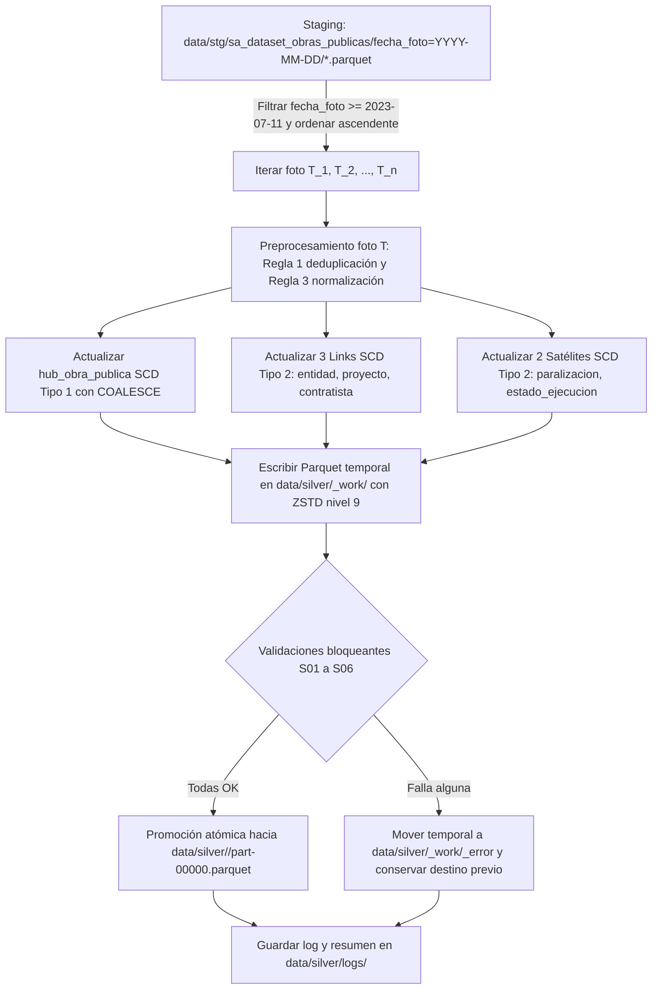

# Carga Incremental de Capa Silver (Hub, Links & Satellites) — Obras Públicas INFOBRAS

*   **Author:** ycalderonf@uni.pe
*   **Status:** Proposed
*   **Date:** 2026-11-18

--------------------------------------------------------------------------------

## Overview

Este documento define el diseño del proceso de carga hacia la capa Silver en [data/silver](file:///c:/ws/formacion/uni-mia/mia-tesis-opa/data/silver) a partir de las particiones históricas ubicadas en la capa Staging ([data/stg/sa_dataset_obras_publicas](file:///c:/ws/formacion/uni-mia/mia-tesis-opa/data/stg/sa_dataset_obras_publicas)).

Actualmente Staging almacena 37 particiones Hive (`fecha_foto=2023-07-11` hasta `fecha_foto=2026-11-01`), que suman 6,576,225 filas y 204,493 códigos `codigo_infobras` únicos. El pipeline Silver lee estas fotos en orden cronológico estricto (desde la más antigua hasta la más reciente) y construye **6 tablas Parquet** bajo un modelo Hub, Links y Satélites (Data Vault + SCD):

1. **`hub_obra_publica`** (Hub central, SCD Tipo 1 con preservación del último valor no nulo `COALESCE(nuevo_valor, valor_actual)`):
   - **Clave de negocio**: `codigo_infobras`
   - **Atributos de dominio `obra` definidos en [data_dictionary.md](file:///c:/ws/formacion/uni-mia/mia-tesis-opa/docs/data_dictionary.md)**: `modalidad_ejecucion_obra`, `naturaleza_obra`, `tipo_obra_nivel_1`, `tipo_obra_nivel_2`, `tipo_obra_nivel_3`, `fecha_inicio_obra`, `fecha_finalizacion_real` (8 columnas de negocio en total incluyendo `codigo_infobras`).
   - **Columnas de auditoría**: `first_seen_date` y `fecha_foto` (última foto en la que apareció la obra).
2. **3 Tablas Link binarias con vigencia temporal (`start_date`, `end_date`, `fecha_foto`)**:
   - **`link_obra_entidad`**: enlaza `codigo_infobras` con `codigo_entidad` (dominio `entidad`, presente en las 204,493 obras; cambia en 927 obras).
   - **`link_obra_proyecto`**: enlaza `codigo_infobras` con `codigo_unico` (dominio `Proyecto`, presente y distinto de `'0'` en 183,177 obras; cambia en 2,321 obras). Solo se registra cuando `codigo_unico IS NOT NULL AND codigo_unico != '0'`.
   - **`link_obra_contratista`**: enlaza `codigo_infobras` con `ruc_1` (dominio `Contratista`, RUC de la empresa contratista de la ejecución; presente en 81,743 obras y cambia en 3,115 obras). Solo se registra cuando `ruc_1 IS NOT NULL`.
3. **2 Tablas Satellite con vigencia temporal (`start_date`, `end_date`, `fecha_foto`)**:
   - **`sat_obra_paralizacion`**: versiona (SCD Tipo 2) cada cambio en la tupla `(flg_existe_paralizacion, causal_paralizacion, fecha_paralizacion)` por `codigo_infobras`.
   - **`sat_obra_estado_ejecucion`**: versiona (SCD Tipo 2) cada cambio del campo `estado_ejecucion` por `codigo_infobras`.

Modelo temporal adoptado en Links y Satélites (Reglas 4 y 5 de [silver_layer_rules.md](file:///c:/ws/formacion/uni-mia/mia-tesis-opa/docs/dataflow/silver_layer_rules.md)):
- **`start_date`**: primera `fecha_foto` en la que inicia una versión del estado o relación.
- **`end_date`**: `fecha_foto` en la que inicia la siguiente versión distinta, o `NULL` mientras la versión siga abierta/vigente. Usar `NULL` en lugar de una fecha centinela (`9999-12-31`) evita distorsiones accidentales al calcular duraciones (`end_date - start_date`).
- **`fecha_foto`**: última fecha de snapshot que confirmó esa versión del registro.

## The Problem

La capa Staging conserva una foto completa de todo el padrón en cada partición mensual (6.58 millones de filas). Consultar la historia de una obra —por ejemplo, cuándo cambió su `estado_ejecucion`, qué contratista ejecutó la obra en una fecha dada o cuántas veces pasó a estado paralizado— obliga actualmente a leer las 37 particiones completas y recalcular diferencias entre fotos en cada consulta.

Adicionalmente, el perfilamiento sobre las 37 particiones reales de Staging reveló cinco condiciones que el pipeline Silver debe resolver siguiendo [silver_layer_rules.md](file:///c:/ws/formacion/uni-mia/mia-tesis-opa/docs/dataflow/silver_layer_rules.md) y [data_dictionary.md](file:///c:/ws/formacion/uni-mia/mia-tesis-opa/docs/data_dictionary.md):

1. **Duplicados dentro de una misma foto**: existen 705 pares `(codigo_infobras, fecha_foto)` repetidos dentro de una misma partición. Según la Regla 1, debe seleccionarse el registro con `fecha_registro_avance` más reciente (desempatando determinísticamente por `ano_avance DESC NULLS LAST, mes_avance DESC NULLS LAST`).
2. **Atributos de ciclo de vida en `hub_obra_publica` que inician en `NULL`**: aunque la estructura de `hub_obra_publica` se modela como SCD Tipo 1 sin historial de versiones, campos como `fecha_inicio_obra` (24,431 obras) y `fecha_finalizacion_real` (26,240 obras) nacen en `NULL` en las primeras fotos y se completan en fotos posteriores. Insertar solo el registro de la primera aparición dejaría esos campos vacíos; por ello deben actualizarse con el último valor no nulo (`COALESCE(nuevo_valor, valor_actual)`).
3. **Relaciones externas opcionales y mutables en los Links**: el 60.0% de las obras (122,750) carece de `ruc_1` (principalmente obras por administración directa o sin ejecución adjudicada) y el 10.4% (21,316) carece de `codigo_unico` válido (`NULL` o `'0'`). Además, 3,115 obras cambian de `ruc_1`, 2,321 cambian de `codigo_unico` y 927 cambian de `codigo_entidad` entre fotos. Separar estas relaciones en tres Links binarios versionados con `(start_date, end_date, fecha_foto)` evita almacenar claves foráneas nulas y conserva el historial de contratistas, proyectos y entidades.
4. **Inconsistencias entre el indicador y la causal de paralización**: existen 503 filas donde `flg_existe_paralizacion = false` pero `causal_paralizacion` contiene texto residual. Según la Regla 3, cuando `flg_existe_paralizacion = false`, no se considera paralización y `causal_paralizacion` y `fecha_paralizacion` deben normalizarse a `NULL` para evitar versiones falsas; cuando `flg_existe_paralizacion = true` y `causal_paralizacion` es `NULL`, se conserva la paralización manteniendo `causal_paralizacion = NULL`.
5. **Obras que dejan de aparecer antes del corte final**: en el inventario previo sobre Staging se observó que alrededor de 13,338 obras dejan de figurar antes de la última foto (`2026-11-01`). Según la Regla 5, su última versión abierta mantiene `end_date = NULL` y conserva en `fecha_foto` la última foto en que la obra apareció.

## Goals

* Poblar `data/silver/hub_obra_publica` garantizando unicidad del 100% sobre `codigo_infobras` (204,493 obras únicas en el inventario actual de 37 particiones), con sus 8 columnas de negocio (`codigo_infobras`, `modalidad_ejecucion_obra`, `naturaleza_obra`, `tipo_obra_nivel_1`, `tipo_obra_nivel_2`, `tipo_obra_nivel_3`, `fecha_inicio_obra`, `fecha_finalizacion_real`) actualizadas como SCD Tipo 1 preservando el último valor no nulo.
* Poblar las tres tablas Link binarias (`link_obra_entidad`, `link_obra_proyecto`, `link_obra_contratista`) sin claves foráneas nulas ni `'0'` en `codigo_unico`, versionando cambios mediante `start_date`, `end_date` y `fecha_foto`.
* Poblar los dos satélites (`sat_obra_paralizacion` y `sat_obra_estado_ejecucion`) procesando las fotos en orden cronológico ascendente (`2023-07-11` → `2026-11-01`), aplicando previamente las Reglas 1 a 5 de [silver_layer_rules.md](file:///c:/ws/formacion/uni-mia/mia-tesis-opa/docs/dataflow/silver_layer_rules.md).
* Soportar tanto la carga histórica completa (reconstrucción desde la primera foto válida) como la carga incremental (procesar solo particiones de `fecha_foto` posteriores a la última foto ya cargada en Silver).

## Non-Goals

* Procesar particiones anteriores a `2023-07-11` donde `flg_existe_paralizacion` no cumple el dominio binario (`true`/`false`) definido en la Regla 2.
* Versionar en esta fase otros atributos o dominios del diccionario (presupuesto del proyecto, expediente técnico, avance físico/financiero, supervisión/residente, `ruc_2` o liquidación/transferencia).
* Cargar las tablas de la capa Silver en PostgreSQL; el almacenamiento destino en esta etapa corresponde a archivos Parquet locales en [data/silver](file:///c:/ws/formacion/uni-mia/mia-tesis-opa/data/silver).
* Corregir errores de negocio en el origen distintos a las reglas documentadas en [silver_layer_rules.md](file:///c:/ws/formacion/uni-mia/mia-tesis-opa/docs/dataflow/silver_layer_rules.md).

## Open Questions

* Ninguna pregunta abierta para la definición de alcance y objetivos.

## Critical User Journeys (CUJs)

### CUJ 1: Carga histórica inicial e incremental desde Staging hacia Silver

* **Given**: Existen particiones Parquet validadas en `data/stg/sa_dataset_obras_publicas/fecha_foto=YYYY-MM-DD` a partir de `2023-07-11`.
* **When**: Se ejecuta el proceso de carga de capa Silver en orden cronológico de `fecha_foto` (histórico completo o incremental para particiones nuevas).
* **Then**:
  1. Cada foto se deduplica a lo sumo en 1 fila por `codigo_infobras` usando `fecha_registro_avance` más reciente (Regla 1) y normaliza `causal_paralizacion` y `fecha_paralizacion` a `NULL` cuando `flg_existe_paralizacion = false` (Regla 3).
  2. `hub_obra_publica` inserta nuevos `codigo_infobras` y actualiza los atributos existentes mediante `COALESCE(nuevo_valor, valor_actual)` junto con `fecha_foto = fecha_foto_actual`.
  3. Los tres Links (`link_obra_entidad`, `link_obra_proyecto`, `link_obra_contratista`) y ambos Satélites (`sat_obra_paralizacion`, `sat_obra_estado_ejecucion`) cierran la versión abierta anterior con `end_date = fecha_foto_actual` y abren nueva versión cuando cambia la clave/atributo (sin insertar Links cuando la clave foránea es `NULL` o `'0'` en `codigo_unico`), o actualizan únicamente `fecha_foto = fecha_foto_actual` cuando no hay cambios.
  4. Las obras ausentes en la foto actual conservan sus versiones abiertas (`end_date = NULL`) con `fecha_foto` de su última aparición (Regla 5).

### CUJ 2: Consulta point-in-time y auditoría de transiciones de una obra

* **Given**: Las 6 tablas (`hub_obra_publica`, `link_obra_entidad`, `link_obra_proyecto`, `link_obra_contratista`, `sat_obra_paralizacion`, `sat_obra_estado_ejecucion`) se encuentran pobladas en `data/silver`.
* **When**: Un analista o pipeline Gold consulta la historia de una obra, sus contratistas sucesivos o su estado vigente a una fecha de corte `T`.
* **Then**: El sistema entrega el perfil maestro desde `hub_obra_publica` y reconstruye las relaciones y estados vigentes a la fecha `T` en los Links y Satélites filtrando `start_date <= T AND (T < end_date OR end_date IS NULL) AND T <= fecha_foto`.

## Technical Plan (Architecture)

### 1. Flujo de datos y arquitectura

El proceso lee las particiones Parquet de la capa Staging en orden cronológico (`fecha_foto >= DATE '2023-07-11'`), mantiene el estado acumulado en tablas en memoria dentro de DuckDB durante la corrida, valida las tablas resultantes en un directorio temporal fuera del destino final (`data/silver/_work/`) y promueve cada tabla de forma atómica a `data/silver/<tabla>/part-00000.parquet`.

### 2. Esquema físico de las 6 tablas en `data/silver/`

Cada tabla se almacena como un archivo Parquet único (`part-00000.parquet`) comprimido con `ZSTD` (`COMPRESSION_LEVEL = 9`), ordenando las filas por clave de negocio y fecha de inicio para mejorar la compresión y acelerar filtros por obra.

#### `data/silver/hub_obra_publica/part-00000.parquet`
*Orden físico*: `ORDER BY codigo_infobras`

| Columna | Tipo DuckDB/Parquet | Nulable | Descripción |
|---|---|---|---|
| `codigo_infobras` | `VARCHAR` | No | Clave de negocio única de la obra pública. |
| `modalidad_ejecucion_obra` | `VARCHAR` | Sí | Modalidad de ejecución (Contrata, Administración directa, etc.). |
| `naturaleza_obra` | `VARCHAR` | Sí | Naturaleza de intervención de la obra. |
| `tipo_obra_nivel_1` | `VARCHAR` | Sí | Clasificador de tipo de obra nivel 1. |
| `tipo_obra_nivel_2` | `VARCHAR` | Sí | Clasificador de tipo de obra nivel 2. |
| `tipo_obra_nivel_3` | `VARCHAR` | Sí | Clasificador de tipo de obra nivel 3. |
| `fecha_inicio_obra` | `DATE` | Sí | Fecha de inicio de la obra (se completa al iniciar ejecución). |
| `fecha_finalizacion_real` | `DATE` | Sí | Fecha de finalización real (se completa al concluir la obra). |
| `first_seen_date` | `DATE` | No | Primera `fecha_foto` en la que apareció la obra en Staging (>= `2023-07-11`). |
| `fecha_foto` | `DATE` | No | Última `fecha_foto` en la que apareció la obra en Staging. |

#### `data/silver/link_obra_entidad/part-00000.parquet`
*Orden físico*: `ORDER BY codigo_infobras, start_date` | *Condición de inserción*: `codigo_entidad IS NOT NULL`

| Columna | Tipo DuckDB/Parquet | Nulable | Descripción |
|---|---|---|---|
| `codigo_infobras` | `VARCHAR` | No | Referencia a `hub_obra_publica`. |
| `codigo_entidad` | `VARCHAR` | No | Código de la entidad pública ejecutora vigente en el tramo. |
| `start_date` | `DATE` | No | Primera `fecha_foto` en que inicia la relación con esa entidad. |
| `end_date` | `DATE` | Sí | `fecha_foto` en que inicia el cambio de entidad, o `NULL` si sigue vigente. |
| `fecha_foto` | `DATE` | No | Última `fecha_foto` que confirmó esta relación. |

#### `data/silver/link_obra_proyecto/part-00000.parquet`
*Orden físico*: `ORDER BY codigo_infobras, start_date` | *Condición de inserción*: `codigo_unico IS NOT NULL AND codigo_unico != '0'`

| Columna | Tipo DuckDB/Parquet | Nulable | Descripción |
|---|---|---|---|
| `codigo_infobras` | `VARCHAR` | No | Referencia a `hub_obra_publica`. |
| `codigo_unico` | `VARCHAR` | No | Código Único de Inversiones (CUI) asociado en el tramo. |
| `start_date` | `DATE` | No | Primera `fecha_foto` en que inicia la relación con ese CUI. |
| `end_date` | `DATE` | Sí | `fecha_foto` en que inicia el cambio de CUI, o `NULL` si sigue vigente. |
| `fecha_foto` | `DATE` | No | Última `fecha_foto` que confirmó esta relación. |

#### `data/silver/link_obra_contratista/part-00000.parquet`
*Orden físico*: `ORDER BY codigo_infobras, start_date` | *Condición de inserción*: `ruc_1 IS NOT NULL`

| Columna | Tipo DuckDB/Parquet | Nulable | Descripción |
|---|---|---|---|
| `codigo_infobras` | `VARCHAR` | No | Referencia a `hub_obra_publica`. |
| `ruc_1` | `VARCHAR` | No | RUC de la empresa o consorcio contratista de ejecución en el tramo. |
| `start_date` | `DATE` | No | Primera `fecha_foto` en que inicia la relación con ese RUC. |
| `end_date` | `DATE` | Sí | `fecha_foto` en que inicia el cambio de contratista, o `NULL` si sigue vigente. |
| `fecha_foto` | `DATE` | No | Última `fecha_foto` que confirmó esta relación. |

#### `data/silver/sat_obra_paralizacion/part-00000.parquet`
*Orden físico*: `ORDER BY codigo_infobras, start_date`

| Columna | Tipo DuckDB/Parquet | Nulable | Descripción |
|---|---|---|---|
| `codigo_infobras` | `VARCHAR` | No | Referencia a `hub_obra_publica`. |
| `flg_existe_paralizacion` | `BOOLEAN` | No | Indicador binario de paralización (`true` / `false`). |
| `causal_paralizacion` | `VARCHAR` | Sí | Causal reportada; `NULL` cuando `flg_existe_paralizacion = false` o si origen es nulo con `true`. |
| `fecha_paralizacion` | `DATE` | Sí | Fecha de paralización; `NULL` cuando `flg_existe_paralizacion = false`. |
| `start_date` | `DATE` | No | Primera `fecha_foto` donde inicia esta combinación de atributos. |
| `end_date` | `DATE` | Sí | `fecha_foto` donde inicia el siguiente estado distinto, o `NULL` si está abierta. |
| `fecha_foto` | `DATE` | No | Última `fecha_foto` que confirmó este estado. |

#### `data/silver/sat_obra_estado_ejecucion/part-00000.parquet`
*Orden físico*: `ORDER BY codigo_infobras, start_date`

| Columna | Tipo DuckDB/Parquet | Nulable | Descripción |
|---|---|---|---|
| `codigo_infobras` | `VARCHAR` | No | Referencia a `hub_obra_publica`. |
| `estado_ejecucion` | `VARCHAR` | No | Estado de ejecución de la obra (`Sin Ejecución`, `En Ejecución`, `Paralizada`, `Finalizado`). |
| `start_date` | `DATE` | No | Primera `fecha_foto` donde inicia este estado. |
| `end_date` | `DATE` | Sí | `fecha_foto` donde inicia el siguiente estado distinto, o `NULL` si está abierta. |
| `fecha_foto` | `DATE` | No | Última `fecha_foto` que confirmó este estado. |

### 3. Algoritmo de actualización cronológica foto a foto (`T_1, T_2, ..., T_n`)

Para cada partición `T` en orden ascendente de `fecha_foto`:

1. **Preprocesamiento de la foto `T` (en memoria)**:
   - **Deduplicación (Regla 1)**: filtrar `codigo_infobras IS NOT NULL` y particionar por `codigo_infobras` ordenando por `fecha_registro_avance DESC NULLS LAST, ano_avance DESC NULLS LAST, mes_avance DESC NULLS LAST`, tomando `ROW_NUMBER() = 1`.
   - **Normalización de paralización (Regla 3)**: cuando `flg_existe_paralizacion = FALSE`, fijar `causal_paralizacion = NULL` y `fecha_paralizacion = NULL`. Cuando `flg_existe_paralizacion = TRUE` y `causal_paralizacion IS NULL`, conservar ambos tal cual.

2. **Actualización de `hub_obra_publica` (SCD Tipo 1)**:
   - **Obra nueva** (`codigo_infobras` no existe en `hub_obra_publica`): insertar la fila con los 7 atributos de negocio de la foto `T`, `first_seen_date = T` y `fecha_foto = T`.
   - **Obra existente en `hub_obra_publica` presente en la foto `T`**: actualizar los 7 atributos de negocio aplicando `COALESCE(foto.col, hub.col)` (con lo cual los campos que nacen nulos como `fecha_inicio_obra` o `fecha_finalizacion_real` se completan en cuanto aparezcan) y actualizar `fecha_foto = T`.
   - **Obra ausente en la foto `T`**: no modificar su registro en `hub_obra_publica`.

3. **Actualización de Links y Satélites (SCD Tipo 2)**:
   Para cada una de las 5 tablas versionadas, tomando de la foto `T` solo las filas que cumplen su condición de presencia (en Links: clave foránea `NOT NULL`, y `!= '0'` para `codigo_unico`; en Satélites: todas las filas deduplicadas de la foto `T`):
   - **Caso 1 — Obra sin versión abierta previa (`end_date IS NULL`) en la tabla**: insertar nueva fila con `start_date = T`, `end_date = NULL` y `fecha_foto = T`.
   - **Caso 2 — Obra con versión abierta previa cuyos atributos de seguimiento son iguales (`IS NOT DISTINCT FROM`)**: mantener `start_date` y `end_date = NULL` intactos y actualizar únicamente `fecha_foto = T`.
   - **Caso 3 — Obra con versión abierta previa y cambio en al menos un atributo de seguimiento (`IS DISTINCT FROM`)**:
     1. Cerrar la versión abierta previa actualizando `end_date = T` (manteniendo su `fecha_foto` en la última foto anterior que la confirmó).
     2. Insertar la nueva versión con `start_date = T`, `end_date = NULL` y `fecha_foto = T`.
   - **Caso 4 — Obra ausente en la foto `T` (o cuya clave foránea en la foto `T` pasó a ser `NULL` / `'0'` en un Link)**: no modificar la versión abierta (`end_date` permanece `NULL` y `fecha_foto` conserva la última fecha en que la relación o estado fue observada, cumpliendo la Regla 5).

### 4. Modos de ejecución y validaciones (`S01`–`S06`)

* **Modos de ejecución**:
  * **`PRUEBA`**: procesa únicamente un subconjunto acotado de fotos (por ejemplo, las primeras `N` particiones desde `2023-07-11` o un rango `FECHA_INICIO`/`FECHA_FIN` corto) escribiendo en una ruta aislada o validando las transiciones paso a paso antes de correr el historial completo.
  * **`COMPLETA`**: reconstruye desde cero las 6 tablas procesando cronológicamente todas las particiones válidas (`fecha_foto >= DATE '2023-07-11'`) y reemplaza atómicamente `data/silver/`.
  * **`INCREMENTAL`**: lee el estado existente de las 6 tablas en `data/silver/`, obtiene la marca de agua `MAX(fecha_foto)` de `hub_obra_publica` (verificando coherencia entre tablas), y procesa solo las particiones de Staging con `fecha_foto > marca_de_agua` en orden cronológico ascendente antes de promover las nuevas versiones.

* **Validaciones bloqueantes antes de promover desde `data/silver/_work/` (`S01`–`S06`)**:
  * **`S01` (Unicidad del Hub)**: en `hub_obra_publica`, `COUNT(*) = COUNT(DISTINCT codigo_infobras)` y 0 valores `codigo_infobras IS NULL`.
  * **`S02` (A lo sumo una versión abierta)**: en los 3 Links y 2 Satélites, ninguna obra tiene más de 1 fila con `end_date IS NULL`.
  * **`S03` (Integridad temporal SCD Tipo 2)**: en los 3 Links y 2 Satélites, toda fila cumple `start_date <= fecha_foto`, `end_date IS NULL OR start_date < end_date`, y no existen intervalos solapados ni `end_date < start_date` para un mismo `codigo_infobras`.
  * **`S04` (Integridad referencial y de claves)**: todo `codigo_infobras` presente en Links y Satélites existe en `hub_obra_publica`; los 3 Links tienen 0 nulos en su clave foránea y `link_obra_proyecto` tiene 0 filas con `codigo_unico = '0'`.
  * **`S05` (Consistencia Regla 3)**: en `sat_obra_paralizacion`, 0 filas tienen `flg_existe_paralizacion = FALSE` con `causal_paralizacion IS NOT NULL` o `fecha_paralizacion IS NOT NULL`.
  * **`S06` (Paridad de esquema y conteo)**: los 6 archivos Parquet en `_work/` coinciden columna a columna con el esquema y tipos esperados, tienen más de 0 filas y se leen sin errores con DuckDB antes de reemplazar `data/silver/`.

## Alternatives Considered

### Alternative A: Cierre automático de `end_date` ante ausencia de la obra en una foto posterior

*   **Pros**: Permite identificar directamente con `end_date IS NOT NULL` las aproximadamente 13,338 obras que dejaron de publicarse antes del último corte (`2026-11-01`).
*   **Cons**: Si una obra se ausenta en un snapshot mensual por omisión de exportación en la fuente y reaparece en un mes posterior con el mismo estado, divide un único estado continuo en múltiples tramos artificiales.
*   **Reason for Rejection**: Rejected by author: se definió la Regla 5 en [../dataflow/silver_layer_rules.md](../dataflow/silver_layer_rules.md) para mantener `end_date` abierto (`NULL`) cuando una obra deja de aparecer y registrar en `fecha_foto` la última foto en que fue observada, evitando fragmentar estados por ausencias en el padrón.

### Alternative B: Uso de fecha centinela `DATE '9999-12-31'` para versiones abiertas en `end_date`

*   **Pros**: Simplifica filtros de rango temporal a `fecha_corte >= start_date AND fecha_corte < end_date` sin requerir la cláusula `OR end_date IS NULL`.
*   **Cons**: Cualquier cálculo directo de duración (`end_date - start_date`) que olvide filtrar `9999-12-31` introduce duraciones espurias cercanas a 8,000 años (~2.9 millones de días), y cualquier conversión a `datetime64[ns]` en Python falla con `OutOfBoundsDatetime` (límite en el año 2262).
*   **Reason for Rejection**: Rejected by author: se actualizaron las Reglas 4 y 5 en [../dataflow/silver_layer_rules.md](../dataflow/silver_layer_rules.md) para utilizar `end_date = NULL` en toda versión abierta, forzando el uso explícito de `COALESCE(end_date, fecha_foto)` en cálculos de duración y garantizando compatibilidad con `datetime64[ns]`.

### Alternative C: Incluir las 23 columnas relevantes del diccionario dentro de `hub_obra_publica`

*   **Pros**: Concentra en una sola tabla maestra todos los atributos relevantes que aún no cuentan con un satélite propio.
*   **Cons**: Mezcla en el Hub atributos que cambian con alta frecuencia entre fotos (como `n_obras_relacionadas_proyecto`, que varía en 184,133 obras, y `colegiatura_1`, que varía en 108,387 obras), sobrescribiendo valores históricos y generando riesgo de fuga de información temporal (*data leakage*); además, incrusta claves de otras entidades (`codigo_entidad`, `codigo_unico`, `ruc_1`) dentro del Hub de obra.
*   **Reason for Rejection**: Rejected by author: se restringió `hub_obra_publica` a los 8 atributos estructurales y de ciclo de vida del dominio `obra`, separando las relaciones con entidad, proyecto y contratista en tablas Link.

### Alternative D: Una sola tabla Link combinada (`codigo_entidad`, `codigo_unico`, `ruc_1`) o Links SCD Tipo 1 sin historial

*   **Pros**: Reduce la cantidad de tablas Link en `data/silver` de 3 a 1, o simplifica los cruces a relaciones 1:1 si se usa SCD Tipo 1.
*   **Cons**: En una tabla Link combinada, el 60.0% de las obras tendría `ruc_1 = NULL` y el 10.4% no tendría `codigo_unico` válido, violando la integridad de claves en Data Vault y duplicando referencias de entidad y proyecto cada vez que se adjudica o cambia un contratista. Si se usa SCD Tipo 1 en los Links, se pierde el historial de las 3,115 obras que cambian de `ruc_1`, 2,321 que cambian de `codigo_unico` y 927 que cambian de `codigo_entidad`.
*   **Reason for Rejection**: Rejected by author: se eligió modelar 3 tablas Link binarias independientes (`link_obra_entidad`, `link_obra_proyecto`, `link_obra_contratista`) con vigencia temporal (`start_date`, `end_date`, `fecha_foto`) e inserción exclusiva cuando la clave foránea es válida.

--------------------------------------------------------------------------------

## Non-Functional Requirements

*   **Performance & Storage**: El procesamiento cronológico de las 37 particiones (6.58 millones de filas) se ejecuta en DuckDB en memoria y escribe 6 archivos Parquet con compresión `ZSTD` nivel 9 ordenados por `codigo_infobras`.
*   **Rollout, Atomicity & Rollback**: La generación escribe primero en `data/silver/_work/` y ejecuta promoción atómica por tabla únicamente tras aprobar las validaciones `S01`–`S06`; ante cualquier falla de validación, los archivos previos en `data/silver/` permanecen intactos y el detalle queda registrado en `data/silver/logs/`.

--------------------------------------------------------------------------------

### Additional Resources

*   Reglas de negocio de capa Silver: [silver_layer_rules.md](../dataflow/silver_layer_rules.md)
*   Diccionario de atributos válidos y relevantes: [data_dictionary.md](../data_dictionary.md)
*   Mapping de columnas Staging: [stg__dataset_obras_publicas__to__sa_obras_publicas_infobras.yaml](../datamappings/stg__dataset_obras_publicas__to__sa_obras_publicas_infobras.yaml)

### Future Improvements

*   Incorporar satélites adicionales en Silver para el versionado de avance físico y financiero, modificaciones de plazo y adicionales, expediente técnico y personal clave (`colegiatura_1`, `colegiatura_2`).

## Detailed Implementation Plan

### Target Files to Create/Modify

#### 1. `../dataflow/silver_layer_rules.md` (Modify)

*   **Type / Scope**: Documentación de reglas de negocio y modelo de datos de la capa Silver.
*   **Rationale**: Registrar junto a las Reglas 1–5 la definición aprobada de `hub_obra_publica` (8 atributos de negocio con actualización SCD Tipo 1 preservando el último valor no nulo) y las reglas de los 3 Links binarios (`link_obra_entidad`, `link_obra_proyecto`, `link_obra_contratista`) con vigencia `(start_date, end_date, fecha_foto)` para mantener alineada la especificación funcional con el pipeline.
*   **Proposed Changes**:
    *   Agregar la sección `### Reglas de actualización en hub_obra_publica (SCD Tipo 1)` con la Regla 6: conservar un registro único por `codigo_infobras` y actualizar sus 7 atributos de negocio (`modalidad_ejecucion_obra`, `naturaleza_obra`, `tipo_obra_nivel_1`, `tipo_obra_nivel_2`, `tipo_obra_nivel_3`, `fecha_inicio_obra`, `fecha_finalizacion_real`) mediante `COALESCE(nuevo_valor, valor_actual)` para completar fechas de ciclo de vida que nacen en `NULL`, registrando `first_seen_date` y `fecha_foto` de última aparición.
    *   Agregar la sección `### Reglas de entidades Link binarias (SCD Tipo 2)` con la Regla 7: modelar `link_obra_entidad` (`codigo_entidad IS NOT NULL`), `link_obra_proyecto` (`codigo_unico IS NOT NULL AND codigo_unico != '0'`) y `link_obra_contratista` (`ruc_1 IS NOT NULL`) con vigencia `(start_date, end_date, fecha_foto)`.

#### 2. `../../etl/06_carga_silver_parquet.ipynb` (Create)

*   **Type / Scope**: Notebook ETL de procesamiento cronológico Staging → Silver en DuckDB y Parquet.
*   **Rationale**: Implementar en un único artefacto ejecutable la lectura secuencial de las particiones Hive de `data/stg/sa_dataset_obras_publicas`, el mantenimiento de estado SCD Tipo 1 y Tipo 2 de las 6 tablas de la capa Silver, la validación bloqueante `S01`–`S06` en `data/silver/_work/`, la promoción atómica hacia `data/silver/<tabla>/part-00000.parquet` y la generación de logs y resúmenes CSV en `data/silver/logs/`.
*   **Proposed Changes**: Estructurar el notebook en 10 secciones bajo las siguientes firmas y contratos:
    1.  **Parámetros de ejecución**: definir `MODO` (`"PRUEBA" | "COMPLETA" | "INCREMENTAL"`), `N_FOTOS_PRUEBA = 3`, `FECHA_MINIMA = "2023-07-11"`, `COMPRESION = "ZSTD"`, `COMPRESION_NIVEL = 9` y `DETENER_ANTE_ERROR = True`.
    2.  **Configuración y logger**: `configurar_logger() -> logging.Logger`, detección de raíz del proyecto, inicialización de directorios (`STG_DIR`, `SILVER_DIR`, `WORK_DIR`, `LOGS_DIR`) y creación de conexión DuckDB en memoria.
    3.  **Definición declarativa de esquemas (`SCHEMAS_SILVER`)**: declarar columnas, tipos DuckDB/Parquet, nulabilidad y claves de ordenamiento físico para `hub_obra_publica`, `link_obra_entidad`, `link_obra_proyecto`, `link_obra_contratista`, `sat_obra_paralizacion` y `sat_obra_estado_ejecucion`.
    4.  **Descubrimiento de particiones y marca de agua**: `listar_particiones_pendientes(modo: str, fecha_minima: str) -> list[date]`, que lee las particiones Hive en `STG_DIR`, en modo `INCREMENTAL` obtiene la marca de agua `MAX(fecha_foto)` de `data/silver/hub_obra_publica/part-00000.parquet` (validando coherencia entre las 6 tablas) e inicializa las tablas en memoria desde `data/silver/`, y en modo `PRUEBA` toma las primeras `N_FOTOS_PRUEBA` particiones.
    5.  **Preprocesamiento por foto**: `cargar_foto_limpia(con, fecha_foto: date) -> None`, que construye la tabla temporal `foto_actual` de la partición `fecha_foto` aplicando la Regla 1 (deduplicación por `codigo_infobras` ordenando por `fecha_registro_avance DESC NULLS LAST, ano_avance DESC NULLS LAST, mes_avance DESC NULLS LAST`) y la Regla 3 (cuando `flg_existe_paralizacion = FALSE`, fijar `causal_paralizacion = NULL` y `fecha_paralizacion = NULL`).
    6.  **Actualización del Hub**: `actualizar_hub_obra_publica(con, fecha_foto: date) -> dict`, que inserta obras nuevas con `first_seen_date = fecha_foto` y `fecha_foto`, y actualiza obras existentes presentes en `foto_actual` aplicando `COALESCE(foto.col, hub.col)` sobre los 7 atributos de negocio y `fecha_foto = fecha_foto`.
    7.  **Actualización genérica SCD Tipo 2 para Links y Satélites**: `actualizar_tabla_scd2(con, nombre_tabla: str, cols_seguimiento: list[str], filtro_sql: str | None, fecha_foto: date) -> dict`, que aplica la transición cronológica para los 4 casos: obra nueva sin versión abierta (inserta `start_date = fecha_foto, end_date = NULL`), versión abierta sin cambios usando `IS NOT DISTINCT FROM` (actualiza `fecha_foto = fecha_foto`), versión abierta con cambio usando `IS DISTINCT FROM` (cierra versión previa con `end_date = fecha_foto` e inserta nueva versión con `start_date = fecha_foto, end_date = NULL, fecha_foto = fecha_foto`) y obra ausente o con clave foránea nula/inválida en Link (sin cambios, manteniendo Regla 5).
    8.  **Escritura en `_work/` y validaciones `S01`–`S06`**: `escribir_work_parquet(con) -> dict[str, Path]` (exporta cada tabla ordenada con `ZSTD` nivel 9 hacia `data/silver/_work/<tabla>/part-00000.parquet`) y `validar_tablas_silver(rutas_work: dict[str, Path]) -> pd.DataFrame` (ejecuta las 6 validaciones bloqueantes `S01`–`S06` directamente sobre los Parquet temporales).
    9.  **Promoción atómica**: `promover_silver(rutas_work: dict[str, Path]) -> None`, que promueve las 6 tablas desde `_work/` hacia `data/silver/<tabla>/part-00000.parquet` con respaldo temporal `_old` y rollback automático ante fallos de sistema de archivos.
    10. **Reporte de corrida y consultas de auditoría**: persistir el log `.log` y resumen `.csv` en `data/silver/logs/`, mostrar conteos de inserciones/cierres/actualizaciones por foto y verificar la trazabilidad histórica en obras de control (`codigo_infobras IN ('501650', '540677', '166922')`).

### Verification Plan

*   **Validación en modo `PRUEBA` (primeras 3 fotos desde `2023-07-11`)**:
    *   Ejecutar el notebook con `MODO = "PRUEBA"` y `N_FOTOS_PRUEBA = 3`.
    *   Confirmar que las 6 validaciones `S01`–`S06` retornan estado `OK`.
    *   Verificar que los duplicados intra-foto (`705` pares en el universo completo, incluyendo los `154` pares en `2023-07-11` y `2023-08-01`) se reducen exactamente a 1 fila por `codigo_infobras` en cada foto procesada y que se registran cierres (`end_date`) y confirmaciones (`fecha_foto`) entre la foto 1, 2 y 3.
*   **Validación de carga `COMPLETA` (37 particiones, `2023-07-11` a `2026-11-01`)**:
    *   Ejecutar el notebook con `MODO = "COMPLETA"` sobre las 37 particiones.
    *   Verificar que `hub_obra_publica` contiene exactamente `204,493` filas únicas (`S01`: `COUNT(*) = COUNT(DISTINCT codigo_infobras)` y cero `NULL`).
    *   Verificar `S02` (a lo sumo 1 versión con `end_date IS NULL` por `codigo_infobras`), `S03` (cero intervalos solapados y `start_date <= fecha_foto`), `S04` (cero claves foráneas `NULL` en los 3 Links, cero `'0'` en `link_obra_proyecto.codigo_unico` e integridad referencial del 100% contra `hub_obra_publica`) y `S05` (cero filas en `sat_obra_paralizacion` con `flg_existe_paralizacion = FALSE` y `causal_paralizacion IS NOT NULL` o `fecha_paralizacion IS NOT NULL`).
    *   Auditar manualmente obras de control (`501650`, `540677`, `166922`) confirmando que los cambios de `estado_ejecucion`, paralizaciones, contratistas (`ruc_1`) y las obras ausentes antes de `2026-11-01` coinciden con los snapshots de Staging y la Regla 5.
*   **Validación de idempotencia y equivalencia en modo `INCREMENTAL`**:
    *   Ejecutar `MODO = "INCREMENTAL"` inmediatamente después de `COMPLETA` sin particiones nuevas y confirmar que reporta 0 particiones pendientes sin alterar ninguno de los 6 archivos Parquet.
    *   Ejecutar una prueba controlada cargando de forma `COMPLETA` las primeras 36 fotos (`2023-07-11` a `2026-10-01`) y luego procesando la foto 37 (`2026-11-01`) en modo `INCREMENTAL`, verificando que los conteos y registros de las 6 tablas coincidan exactamente con la corrida `COMPLETA` de las 37 fotos.

--------------------------------------------------------------------------------

<!-- Provenance: Indicates initial structural drafting via EGM. -->

*Drafted with EGM*
