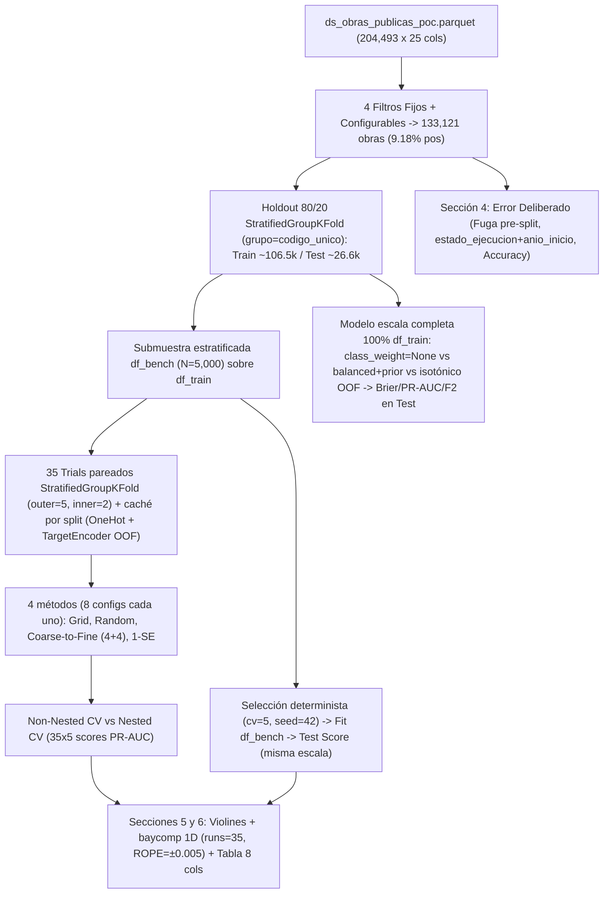

# POC de Clasificación Binaria y Estimación del Riesgo de Paralización de Obras Públicas (`mcies_ml_project`)

*   **Author:** ycalderonf@uni.pe
*   **Status:** Approved
*   **Date:** 2026-11-19

--------------------------------------------------------------------------------

## Overview

Este documento define el diseño técnico y experimental para desarrollar, en [mcies_ml_project](file:///c:/ws/formacion/uni-mia/mia-tesis-opa/mcies_ml_project), un modelo de clasificación binaria general y estimación probabilística del riesgo de paralización de obras públicas en el Perú a partir del dataset Gold [part-00000.parquet](file:///c:/ws/formacion/uni-mia/mia-tesis-opa/data/gold/ds_obras_publicas/part-00000.parquet) (`ds_obras_publicas`, `204,493` obras y `37` columnas).

El objetivo funcional es estimar la probabilidad condicional de que una obra pública sufra al menos una paralización durante su ciclo de ejecución (sin restringir por causal, modalidad ni nivel de gobierno por defecto):

$$p(\mathbf{x}_i) = \Pr(Y_i = 1 \mid \mathbf{X}_i = \mathbf{x}_i), \quad Y_i = \mathbb{I}(\texttt{flg\_existe\_paralizacion}_i = \texttt{True})$$

donde $\hat{p}_i \in [0, 1]$ representa el **riesgo de paralización de obra**, permitiendo jerarquizar proyectos preventivamente y derivar una clasificación dicotómica $\hat{Y}_i = \mathbb{I}(\hat{p}_i \ge c)$ bajo un umbral operativo $c$.

El diseño integra tres pilares:

1.  **Cumplimiento de [Primera Práctica Calificada 2026.pdf](file:///c:/ws/formacion/uni-mia/mia-tesis-opa/mcies_ml_project/Primera%20Pr%C3%A1ctica%20Calificada%202026.pdf)**:
    *   Notebook autocontenido y reproducible en Google Colab (`mcies_ml_project/P1-YanFrancoCalderonFelix.ipynb`) organizado en las 9 secciones evaluadas (20 puntos), sin intervención manual ni archivos comprimidos.
    *   Comparación experimental mediante **35 trials independientes** entre **validación cruzada anidada (`Nested CV`)** y **validación cruzada no anidada (`Non-Nested CV`)** usando `HistGradientBoostingClassifier` sobre cuatro métodos de búsqueda de hiperparámetros con presupuesto homogéneo de 8 configuraciones: `Grid Search`, `Random Search`, `Coarse-to-Fine Search` y `One-Standard-Error Rule`.
    *   Experimento de control con error deliberado (*data leakage* y métrica inadecuada), gráficos de violín de los 35 trials, tabla comparativa de **8 columnas** (`Método` + 7 columnas de evaluación) con test bayesiano correlacionado (`baycomp.two_on_single` sobre vectores 1D de pliegues pareados con `runs=35` y $\text{ROPE} = \pm 0.005$) y evaluación sobre conjunto de prueba retenido (`Test Score`).
2.  **Alineamiento funcional con [main.typ](file:///c:/ws/formacion/uni-mia/mia-tesis-opa/tesis/plan/main.typ) e [Informe_Final_MIES.typ](file:///c:/ws/formacion/uni-mia/mia-tesis-opa/informe/Informe_Final_MIES.typ)**:
    *   **Filtros fijos obligatorios**: `estado_ejecucion != 'Sin Ejecución'`, `fecha_inicio_obra IS NOT NULL`, `codigo_unico IS NOT NULL` y monto válido `COALESCE(NULLIF(monto_aprobado_soles, 0), monto_aprobacion_et) > 1`. Sobre `ds_obras_publicas`, este universo reúne **`133,121` obras** (`12,224` paralizadas = **`9.18 %`** y `120,897` no paralizadas = **`90.82 %`**), entre `2001-07-13` y `2026-10-23`.
    *   **Filtros de dominio configurables**: constantes explícitas en la celda de parámetros (`FILTRO_NIVEL_GOBIERNO = None`, `FILTRO_MODALIDAD_EJECUCION = None`, `FECHA_INICIO_MIN = None`, `FECHA_INICIO_MAX = None`) para ejecutar el experimento sobre el universo general por defecto o acotar una subcohorte sin editar el código del modelo.
3.  **Ingeniería de características pre-inicio adaptada a árboles de gradiente sin fuga (*zero data leakage*)**:
    *   Exclusión estricta de variables post-evento, equivalentes al target, colineales redundantes (`monto_aprobacion_et` en bruto con $r = 0.9999$), conteos potencialmente posteriores (`n_obras_relacionadas_proyecto`) y artefactos de ventana temporal (`anio_inicio`).
    *   Uso directo de transformadores nativos de `scikit-learn` ajustados exclusivamente sobre el conjunto de entrenamiento de cada pliegue (`OneHotEncoder` + `TargetEncoder` con *cross-fitting* OOF de 5 pliegues), preservando los `NaN` estructurales para manejo nativo en `HistGradientBoostingClassifier`.

--------------------------------------------------------------------------------

## The Problem

1.  **Sesgo optimista al seleccionar hiperparámetros con validación cruzada no anidada**:
    Cuando se utiliza la misma validación cruzada para elegir hiperparámetros (`best_score_`) y estimar el error de generalización, la operación $\max$ sobre múltiples candidatos incorpora el ruido muestral de los pliegues de validación (Cawley & Talbot, 2010). En un dataset desbalanceado (`9.18 %` de paralizaciones) con variables de alta cardinalidad (`2,345` entidades, `1,734` distritos), un árbol de gradiente con mayor complejidad (`max_leaf_nodes` alto, baja regularización `l2`) sobreajusta los pliegues internos y produce un score no anidado superior al rendimiento real en datos nuevos.
2.  **Incompatibilidad entre `TimeSeriesSplit` determinista y los 35 trials independientes**:
    En el proyecto previo ([proyecto_final_modelado.ipynb](file:///c:/ws/formacion/uni-mia/mia-tesis-opa/mead_project/proyecto_final_modelado.ipynb)) se empleó `TimeSeriesSplit`. Dado que `TimeSeriesSplit` es determinista, repetir 35 trials de `Grid Search` o `One-Standard-Error` produce **35 valores idénticos (`std = 0`)**, colapsando los gráficos de violín (Sección 5) e impidiendo calcular el test bayesiano correlacionado (`baycomp.two_on_single`, Sección 6). Además, un split cronológico crudo `70 % / 30 %` sobre `2001–2026` genera un salto de prevalencia de `4.94 %` en `Train` a `19.08 %` en `Test` por truncamiento izquierdo (fotos desde `2023-07-11`) y censura derecha (`2026: 4.50 %`), haciendo incomparables `PR-AUC` y `Brier Score`.
3.  **Características desafiantes simultáneas en `ds_obras_publicas`**:
    *   **Desbalance de clases (`9.18 %` positivos vs `90.82 %` negativos)**: invalida métricas como *Accuracy* (un clasificador trivial constante `0` logra `90.82 %` con `Recall = 0`).
    *   **Valores faltantes estructurales**: `ruc_1` y `monto_contrato_soles_eje` tienen `46.13 %` de nulos en obras ejecutadas por *Administración directa* y *Núcleo ejecutor*; `ruc_2` (`82.24 %`) y `monto_contrato_soles_sup` (`91.83 %`) faltan cuando no hay supervisión contratada aparte; `tipo_formato` tiene `16.41 %` de nulos.
    *   **Alta colinealidad presupuestal**: `corr(log1p(monto_aprobado_soles), log1p(monto_aprobacion_et)) = 0.9999`.
    *   **Agrupamiento por proyecto de inversión (`codigo_unico`)**: distintas obras comparten un mismo proyecto (`122,148` proyectos para `133,121` obras), lo que exige particionar manteniendo cada `codigo_unico` aislado en un solo pliegue.

--------------------------------------------------------------------------------

## Goals

*   **G1 — Cohorte general con filtros fijos y parámetros opcionales**: Cargar el dataset compacto desde `mcies_ml_project/data/ds_obras_publicas_poc.parquet` (y descarga HTTPS automática desde `DATA_URL` en Colab), aplicar los 4 filtros fijos (`133,121` obras, `9.18 %` positivas) y exponer parámetros opcionales de filtrado (`FILTRO_NIVEL_GOBIERNO`, `FILTRO_MODALIDAD_EJECUCION`, rango de fechas y `N_MUESTRA_TRAIN_BENCHMARK`).
*   **G2 — Pipeline sin fuga de grupo ni *in-fold overfitting***: Excluir toda variable post-evento o artefacto temporal, aislar el `codigo_unico` mediante `StratifiedGroupKFold` tanto en el holdout (`80/20`) como en CV (`outer=5, inner=2`), codificar baja cardinalidad con `OneHotEncoder` y media/alta cardinalidad con `TargetEncoder` OOF (`cv=5`, `smooth=20.0`) ajustado únicamente dentro de entrenamiento, y conservar `NaN` nativos en numéricas y razones pre-inicio.
*   **G3 — Benchmark pareado de 35 trials (`Nested CV` vs `Non-Nested CV`)**: Ejecutar 35 trials independientes comparando `Grid Search`, `Random Search`, `Coarse-to-Fine Search` y `One-Standard-Error Rule` con presupuesto homogéneo de `8` configuraciones sobre `HistGradientBoostingClassifier` en `PR-AUC` (`average_precision`).
*   **G4 — Experimento de control con error deliberado (Sección 4)**: Cuantificar el engaño producido por (a) *data leakage* en codificación supervisada pre-split, (b) inclusión de variables con fuga operativa/temporal (`estado_ejecucion` y `anio_inicio` evaluados prospectivamente en `2023–2024 -> 2025`), y (c) evaluación mediante *Accuracy* sobre desbalance `9.18 %`.
*   **G5 — Visualización, test bayesiano (`baycomp`), tabla de 8 columnas y estimación calibrada del riesgo $\hat{p}_i$**: Generar gráficos de violín, calcular probabilidades posteriores por pares (`baycomp.two_on_single` 1D con `runs=35` y `rope=0.005`), evaluar `Test Score` en paridad muestral para la tabla comparativa y entrenar el modelo final sobre el **100 % de `df_train`** contrastando `class_weight=None` frente a `class_weight="balanced"` + corrección de prior / calibración isotónica OOF en `Brier Score`, `PR-AUC`, `ROC-AUC` y $F_2$.
*   **G6 — Entregable Colab completo (Secciones 1, 8 y 9)**: Producir `mcies_ml_project/P1-YanFrancoCalderonFelix.ipynb` reproducible de inicio a fin sin intervención manual, incluyendo documentación completa de uso de IA generativa (con casos corregidos manualmente) y aprendizajes.

--------------------------------------------------------------------------------

## Non-Goals

*   **NG1**: No se restringe la variable objetivo a incumplimiento contractual; el target modela la paralización general de obra (`flg_existe_paralizacion`).
*   **NG2**: No se integran fuentes externas ausentes en `ds_obras_publicas` (`INCO`, `IGEIP`, `marco`), ni trayectorias longitudinales completas `sat_obra_paralizacion` (reservadas para la fase de tesis con horizonte $\tau$ y observabilidad $R_i^{(\tau)}$).
*   **NG3**: No se comparan múltiples familias de estimadores dentro del bucle de 35 trials; la búsqueda se acota a `HistGradientBoostingClassifier` para mantener comparación justa entre los cuatro algoritmos de búsqueda.

--------------------------------------------------------------------------------

## Critical User Journeys (CUJs)

### CUJ 1: Ejecución reproducible en Google Colab y entorno local (`P1-YanFrancoCalderonFelix.ipynb`)

*   **Given**: El usuario o evaluador abre `mcies_ml_project/P1-YanFrancoCalderonFelix.ipynb` en Google Colab o Jupyter local.
*   **When**: Ejecuta *"Run all"* sin subir archivos ni autenticar Google Drive.
*   **Then**: El notebook verifica/instala `baycomp` si falta, resuelve el archivo Parquet compacto automáticamente (ruta local o descarga HTTPS directa desde `DATA_URL`), ejecuta las 9 secciones en tiempo acotado (< 8 min) y genera todas las tablas, violines, curvas de calibración, test bayesiano ROPE y la tabla comparativa de 8 columnas.

### CUJ 2: Cuantificación del sesgo optimista y selección del mejor método de búsqueda

*   **Given**: Las 35 repeticiones pareadas (`35 × 5 = 175` pliegues externos por método) de `Non-Nested CV` y `Nested CV` sobre la misma muestra `df_bench` y el `Test Score` en paridad de escala.
*   **When**: Se inspeccionan los gráficos de violín, las diferencias pareadas $\delta_t = \text{Non-Nested}_t - \text{Nested}_t$ y los contrastes por pares `baycomp.two_on_single(..., rope=0.005, runs=35)`.
*   **Then**: Se determina con evidencia empírica y probabilística si `Non-Nested CV` sobreestima el desempeño real frente a `Nested CV` y `Test Score`, y qué estrategia ofrece la mejor relación entre rendimiento, estabilidad (menor dispersión) y costo computacional.

--------------------------------------------------------------------------------

## Technical Plan (Architecture)

### 1. Flujo arquitectónico y portabilidad Colab

Para cumplir el requisito *"reproducible de inicio a fin sin intervención manual"* sin violar el control de peso en Git, se añade en [.gitignore](file:///c:/ws/formacion/uni-mia/mia-tesis-opa/.gitignore) una excepción explícita para `!mcies_ml_project/data/` y `!mcies_ml_project/data/ds_obras_publicas_poc.parquet` (`204,493 × 25`, `5.34 MB` ZSTD-9). El notebook lee los datos en orden automático: `./data/ds_obras_publicas_poc.parquet` → `./mcies_ml_project/data/ds_obras_publicas_poc.parquet` → `../data/gold/ds_obras_publicas/part-00000.parquet` → descarga HTTPS directa desde `DATA_URL` (GitHub raw en rama `main`), usando un lector dual `cargar_parquet()` (`pandas.read_parquet` con respaldo `duckdb`).

---

### 2. Selección de cohorte, exclusión de fuga e ingeniería de características

#### A. Filtros fijos y parámetros configurables

| Tipo | Regla aplicada | Efecto sobre `ds_obras_publicas` |
|---|---|---|
| Fijo 1 | `estado_ejecucion != 'Sin Ejecución'` | Excluye obras sin inicio físico |
| Fijo 2 | `fecha_inicio_obra IS NOT NULL` | Excluye obras sin fecha de inicio |
| Fijo 3 | `codigo_unico IS NOT NULL` | Excluye obras sin proyecto de inversión |
| Fijo 4 | `monto_aprobado_soles = COALESCE(NULLIF(monto_aprobado_soles, 0), monto_aprobacion_et)` y filtro `> 1` | Depura ceros con monto de ET y descarta valores inválidos (`n = 133,121`; `12,224` positivas = `9.18 %`) |
| Configurables | `FILTRO_NIVEL_GOBIERNO = None`, `FILTRO_MODALIDAD_EJECUCION = None`, `FECHA_INICIO_MIN = None`, `FECHA_INICIO_MAX = None`, `N_MUESTRA_TRAIN_BENCHMARK = 5_000` | Permiten ejecutar sobre el universo general por defecto o restringir a una subcohorte desde la celda de configuración |

#### B. Exclusión estricta de variables por fuga de información y redundancia

*   **Target y equivalentes post-evento**: `flg_existe_paralizacion` ($Y$), `ind_opa_*` (7 contadores), `causal_paralizacion_ultimo`, `estado_ejecucion` (solo usada en Filtro Fijo 1, nunca como predictor porque contiene `'Paralizada'`), `fecha_finalizacion_real`, `fecha_foto`.
*   **Fuga futura por agregados de proyecto o ventana de observación**: `n_obras_relacionadas_proyecto` (puede incrementarse por *saldos de obra* posteriores a una paralización) y `anio_inicio` (captura el truncamiento izquierdo `2014–2020: ~4.5 %` y censura derecha `2026: 4.50 %` de las fotos Silver en lugar de riesgo estructural; se mantienen solo `mes_inicio_sin` y `mes_inicio_cos`).
*   **Colinealidad extrema**: `monto_aprobacion_et` en bruto (`corr = 0.9999` con `monto_aprobado_soles` limpio en escala logarítmica), reemplazado por `ratio_aprobado_et`.
*   **Claves**: `codigo_infobras` (solo auditoría) y `codigo_unico` (solo parámetro `groups` en `StratifiedGroupKFold`).

#### C. Transformación minimalista optimizada para `HistGradientBoostingClassifier`

Como `HistGradientBoostingClassifier` es un modelo basado en árboles por histogramas (`max_bins=64`, invariante a transformaciones estrictamente monótonas y con soporte nativo de `NaN`), se descarta el preprocesamiento lineal redundante (`WinsorLogTransformer`, `StandardScaler`, `WOEEncoderOOF` custom y `CausalEntityHistoryEncoder`):

1.  **Función pura pre-inicio `preparar_features_base(df)`**: genera `10` variables numéricas/banderas pre-inicio reemplazando todo `±inf` por `np.nan`:
    *   `monto_aprobado_soles` (float32, preservando escala monetaria limpia; en EDA se grafica en escala $\log(1+x)$).
    *   `ratio_aprobado_et = np.where(monto_aprobacion_et > 1, monto_aprobado_soles / monto_aprobacion_et, np.nan)`.
    *   `ratio_contrato_aprobado = monto_contrato_soles_eje / monto_aprobado_soles` (conserva `NaN` cuando no existe contratista externo).
    *   `ratio_supervision_aprobado = monto_contrato_soles_sup / monto_aprobado_soles` (conserva `NaN` cuando no hay supervisión contratada aparte).
    *   `plazo_aprobacion_a_inicio_dias = np.where(raw_plazo >= 0, raw_plazo, np.nan)` donde `raw_plazo = (fecha_inicio_obra - fecha_aprobacion_expediente).dt.days` (trata `NaT` y negativos como `NaN` junto con la bandera `flg_tiene_fecha_aprobacion_et`).
    *   `flg_tiene_contratista_eje` (`ruc_1.notna()`), `flg_tiene_supervision` (`ruc_2.notna()`).
    *   `mes_inicio_sin`, `mes_inicio_cos` (estacionalidad mensual cíclica del inicio).
2.  **`ColumnTransformer` por pliegue (ajustado solo en entrenamiento de cada fold)**:
    *   **Baja cardinalidad (`5` cols)**: `OneHotEncoder(handle_unknown="infrequent_if_exist", min_frequency=20, sparse_output=False)` sobre `nivel_gobierno`, `modalidad_ejecucion_obra`, `naturaleza_obra`, `tipo_formato` (rellenando nulos con token explícito `'__missing__'` para preservar la señal de faltante estructural de `16.41 %`) y `tipo_obra_nivel_1`.
    *   **Media y alta cardinalidad (`7` cols)**: `sklearn.preprocessing.TargetEncoder(cv=StratifiedKFold(n_splits=5, shuffle=True, random_state=42), smooth=20.0, target_type="binary")` (con fallback compatible `cv=5, random_state=42` si la versión de sklearn en Colab es `< 1.9`) sobre `tipo_obra_nivel_2`, `tipo_obra_nivel_3`, `departamento`, `provincia`, `distrito`, `sector_entidad` y `codigo_entidad`.
    *   **Numéricas (`10` cols)**: `"passthrough"`, preservando todos los `NaN` estructurales nativamente para `HistGradientBoostingClassifier`.
    *   (De forma puntual en la Sección 2 de EDA se calcula además el *Information Value* ($\text{IV}$) sobre `df_train` como diagnóstico descriptivo.)

---

### 3. Protocolo experimental de 35 trials (`Nested CV` vs `Non-Nested CV`)

#### A. Particiones aisladas por `codigo_unico` y caché libre de fuga

1.  **Holdout `80 %` / `20 %`**: `StratifiedGroupKFold(n_splits=5, shuffle=True, random_state=42)` agrupado por `codigo_unico` (`df_train` ≈ `106,496` obras con `9.18 %` positivas; `df_test` ≈ `26,625` obras con `9.18 %` positivas; cero `codigo_unico` compartidos).
2.  **Submuestra estratificada `df_bench`**: `N_MUESTRA_TRAIN_BENCHMARK = 5_000` extraída de `df_train` mediante `StratifiedShuffleSplit(train_size=min(N_MUESTRA_TRAIN_BENCHMARK, len(df_train)), random_state=42)`, conservando `~459` eventos positivos y prevalencia `9.18 %`.
3.  **Pliegues pareados por trial ($t \in \{0, \dots, 34\}$)**:
    *   `outer_cv(t) = StratifiedGroupKFold(n_splits=5, shuffle=True, random_state=100 + t)` (`~4,000` train / `~1,000` val por pliegue externo).
    *   `inner_cv(t) = StratifiedGroupKFold(n_splits=2, shuffle=True, random_state=500 + t)` (`~2,000` train / `~2,000` val por pliegue interno).
    *   En cada trial $t$, **todos los pliegues externos e internos son idénticos entre los 4 métodos**, ajustando `ColumnTransformer` **una sola vez por cada split `(tr, val)`** (`5` outer + `10` inner = `15` fits de codificación por trial) y reutilizando la matriz `float32` resultante exclusivamente dentro de ese mismo pliegue (cero fuga entre folds).
4.  **Estimador base y métrica**: `HistGradientBoostingClassifier(class_weight=None, max_iter=25, max_bins=64, min_samples_leaf=25, early_stopping=False, random_state=42)`, optimizando y evaluando `average_precision_score` (`PR-AUC`). El paralelismo `joblib.Parallel(n_jobs=-1)` se aplica sobre los 35 trials fijando `threadpool_limits(limits=1)` dentro de cada worker.

#### B. Espacio homogéneo y definición exacta de los 4 métodos (`8` evaluaciones por búsqueda)

Los 4 métodos exploran exactamente los mismos **3 hiperparámetros** (`max_leaf_nodes`, `learning_rate`, `l2_regularization`):

| Método | Espacio y regla determinista (`8` evaluaciones) | `Non-Nested CV` (trial $t$) | `Nested CV` (trial $t$) |
|---|---|---|---|
| **1. Grid Search** | Malla $2 \times 2 \times 2 = 8$: `max_leaf_nodes` $\in \{7, 45\}$, `learning_rate` $\in \{0.05, 0.18\}$, `l2_regularization` $\in \{0.1, 15.0\}$. | Media sobre `outer_cv(t)` del mejor candidato $k^*$ ($\max_k \bar{s}_k$) + registro de sus 5 scores por fold. | En cada pliegue externo $j$, evalúa las 8 configs en `inner_cv(t)`, toma $\hat{\theta}_j^*$ (desempate por parsimonia), reentrena en $X_{\text{tr}}^{(j)}$ y evalúa en $X_{\text{val}}^{(j)}$ (guarda los 5 scores por fold). |
| **2. Random Search** | `8` muestras aleatorias uniformes/log-uniformes en `[7, 45] × LogUniform(0.03, 0.25) × LogUniform(0.1, 20.0)` con semilla `1000 + t` (en Nested: `1000 + t*10 + j`). | Mejor score medio entre las 8 configuraciones evaluadas en `outer_cv(t)` + sus 5 scores por fold. | En cada $j$, evalúa 8 configuraciones aleatorias sobre `inner_cv(t)`, selecciona la mejor, reentrena en $X_{\text{tr}}^{(j)}$ y evalúa en $X_{\text{val}}^{(j)}$. |
| **3. Coarse-to-Fine Search** | **Etapa 1 (4 configs)**: `[(7, 0.05, 1.0), (7, 0.18, 1.0), (45, 0.05, 1.0), (45, 0.18, 1.0)]`. **Etapa 2 (4 configs)**: plantilla determinista alrededor del ganador $(L^*, \text{lr}^*)$ de Etapa 1: `[(max(5, round(0.75*L*)), lr*, 0.1), (max(5, round(0.75*L*)), lr*, 15.0), (min(63, round(1.35*L*)), max(0.02, round(0.75*lr*, 4)), 5.0), (min(63, round(1.35*L*)), min(0.25, round(1.25*lr*, 4)), 15.0)]`. | Mejor score medio global entre los 8 puntos evaluados sobre `outer_cv(t)` + sus 5 scores por fold. | Ejecuta Etapa 1 + Etapa 2 estrictamente sobre `inner_cv(t)` dentro de $X_{\text{tr}}^{(j)}$, selecciona el mejor de los 8, reentrena en $X_{\text{tr}}^{(j)}$ y evalúa en $X_{\text{val}}^{(j)}$. |
| **4. One-standard-error** | Sobre los `cv_results_` de `Grid Search`: calcula $\mu^* = \max_k \bar{s}_k$ (desempate por parsimonia) y $\text{SE}^* = \text{std}(s_{k^*}, \text{ddof}=1) / \sqrt{K}$. Filtra $\bar{s}_k \ge \mu^* - \text{SE}^*$ y elige el menos complejo según orden lexicográfico `(max_leaf_nodes ASC, -l2_regularization ASC, learning_rate ASC)`. | Aplica regla 1-SE sobre `Grid Search` en `outer_cv(t)` ($K=5$) y registra $\bar{s}_{\text{1SE}}$ más sus 5 scores por fold. | En cada $j$, aplica regla 1-SE sobre los `K=2` pliegues de `inner_cv(t)`, reentrena el modelo parsimonioso elegido en $X_{\text{tr}}^{(j)}$ y evalúa en $X_{\text{val}}^{(j)}$. |

---

### 4. Cálculo del `Test Score` en paridad muestral y estimación calibrada de riesgo $\hat{p}_i$

1.  **`Test Score` comparable en la Tabla de Sección 6**: para evitar la distorsión de comparar CV (`4,000–5,000` filas) contra un entrenamiento 20× mayor, cada uno de los 4 métodos ejecuta una búsqueda determinista con `StratifiedGroupKFold(n_splits=5, shuffle=True, random_state=42)` sobre `df_bench` (con el mismo presupuesto de 8 configuraciones y regla `1-SE` para el 4.º método), selecciona $\hat{\theta}_{\text{final}}^{(m)}$, ajusta el `Pipeline` sobre `df_bench` (`N = 5,000`) y evalúa `PR-AUC` en `df_test` (`26,625` obras). Complementariamente se registra el promedio sobre `df_test` de las configuraciones elegidas en los 35 trials.
2.  **Modelo final a escala completa (`100 % df_train` ≈ `106,496` obras → `df_test`) y calibración de riesgo (Sección 6.4)**: usando el mejor método y la arquitectura ganadora reentrenada sobre el `100 %` de `df_train`, se comparan explícitamente en `df_test` (`PR-AUC`, `ROC-AUC`, `Brier Score`, intercepto/pendiente de calibración, curva de confiabilidad y $F_2$):
    *   Variante A: `class_weight=None` (probabilidades calibradas nativamente al prior `9.18 %`).
    *   Variante B: `class_weight="balanced"` crudo vs corregido por `prior correction` analítica (`ec-correccion-prior`).
    *   Variante C: `CalibratedClassifierCV(..., method="isotonic", cv=5)` ajustado OOF dentro de `df_train`.
    El umbral operativo $c^*$ para $F_2$ se selecciona exclusivamente sobre las predicciones OOF de `df_train` en la grilla `np.arange(0.01, 0.96, 0.01)`.

---

### 5. Experimento de Control (Sección 4 — Error Deliberado)

1.  **Error A1 — *Data Leakage* por codificación supervisada pre-split**: ajustar `TargetEncoder` sobre el 100 % de `df_bench` antes de dividir los 5 folds y reportar `PR-AUC` en validación frente al flujo limpio.
2.  **Error A2 — *Data Leakage* post-evento y artefacto temporal (`2023–2024 -> 2025`)**: entrenar sobre obras `2023–2024` incluyendo `estado_ejecucion` (contiene `'Paralizada'`) y `anio_inicio`, midiendo el colapso frente a evaluación prospectiva en `2025` sin columna post-evento.
3.  **Error B — Métrica inadecuada (*Accuracy* al umbral `0.50`)**: mostrar cómo un clasificador con `Accuracy ≈ 90.8 %` en `df_test` obtiene `Recall` mínimo y fracasa para priorizar obras en riesgo.

---

### 6. Gráficos de violín, test bayesiano (`baycomp`) y tabla de 8 columnas (Secciones 5 y 6)

*   **Violines (Sección 5)**: `seaborn.violinplot` + dispersión individual de los 35 trials comparando `Non-Nested CV` vs `Nested CV` en los 4 métodos, más distribución de $\delta_t = \text{Non-Nested}_t - \text{Nested}_t$ (sesgo optimista), IQR, desviación estándar y estabilidad.
*   **Test bayesiano correlacionado (Sección 6)**: para los $\binom{4}{2} = 6$ pares entre métodos sobre `Nested CV`, y para `Non-Nested` vs `Nested` en cada método, se invoca `baycomp.two_on_single(scores_a.ravel(), scores_b.ravel(), rope=0.005, runs=35, plot=True, names=(A, B))` pasando los **175** scores externos pareados en formato 1D (`35 × 5`), donde `p_left` representa la ventaja práctica de `x` ($\text{PR-AUC}_A - \text{PR-AUC}_B > 0.005$), `p_rope` la equivalencia práctica ($\pm 0.005$) y `p_right` la ventaja de `y`. En la **tabla comparativa de 8 columnas** (`Método`, `Non-nested CV (mean/std)`, `Nested CV (mean/std)`, `Test Score`, `Ranking (gráfico)`, `Ranking (test bayesiano)`, `¿Resultado confiable? (sí/no + justificación)`, `Posible fuente de sesgo`):
    *   `Ranking (gráfico)`: posición `1..4` ordenada por mediana/IQR de `Nested CV` señalando empates cuando hay amplio solapamiento intercuartílico.
    *   `Ranking (test bayesiano)`: puntuación por pares (`+1` si $P(\text{gana}) \ge 0.90$, `+0.5` si empate práctico o $P < 0.90$) agregada sobre las 6 comparaciones pareadas.

--------------------------------------------------------------------------------

## Alternatives Considered

### Alternative A: Utilizar `TimeSeriesSplit` determinista en los 35 trials

*   **Pros**: Mantiene orden cronológico literal dentro de cada sub-pliegue de CV.
*   **Cons**: Al carecer de componente aleatorio, produce desviación estándar nula (`std = 0`) en métodos deterministas, rompe los violines y `baycomp`, y sobre `2001–2026` induce un salto de prevalencia de `4.94 %` a `19.08 %` entre pasado y futuro por el truncamiento izquierdo de las fotos Silver (`>= 2023-07-11`).
*   **Reason for Rejection**: Rejected by author: se emplea `StratifiedGroupKFold` (`codigo_unico`) manteniendo prevalencia constante `9.18 %` y se aísla la deriva temporal en el Experimento de Control (Subcaso A2) y las consideraciones de censura derecha.

### Alternative B: Mantener `CausalEntityHistoryEncoder` y `WOEEncoderOOF` custom en GBDT

*   **Pros**: Replica literalmente la arquitectura lineal de [proyecto_final_modelado.ipynb](file:///c:/ws/formacion/uni-mia/mia-tesis-opa/mead_project/proyecto_final_modelado.ipynb).
*   **Cons**: Bajo `StratifiedGroupKFold` aleatorio, un lag de 180 días sobre `flg_existe_paralizacion` sin horizonte $\tau$ filtra paralizaciones futuras hacia obras previas de la misma entidad y degenera cuando `df_bench = 5,000`; además `HistGradientBoostingClassifier` es invariante a `log1p`/`StandardScaler`, y `sklearn.preprocessing.TargetEncoder` ya realiza *cross-fitting* bayesiano OOF sin código custom redundante.
*   **Reason for Rejection**: Rejected by author: se reemplaza por `TargetEncoder` OOF nativo y `Ordinal`/`OneHot` sin fuga, difiriendo las variables históricas longitudinales estrictas ($\mathcal{J}_{e,i}$ con $t_{0j}+\tau+\delta \le t_{0i}$) al trabajo de tesis con horizonte $\tau$.

### Alternative C: Restringir el POC solo a Gobierno Nacional por Contrata (`n=7,925`) o causal contractual

*   **Pros**: Continuidad exacta con el subconjunto de `Informe_Final_MIES.typ` (`13.94 %` positivos).
*   **Cons**: Excluye Gobiernos Locales y Regionales y modalidades como Administración Directa (`94 %` del universo válido de `ds_obras_publicas`), y no responde al objetivo del POC sobre paralización general.
*   **Reason for Rejection**: Rejected by author: el pipeline usa por defecto los 4 filtros fijos generales (`n = 133,121`) y expone parámetros configurables para subcohortes.

--------------------------------------------------------------------------------

## Non-Functional Requirements

*   **Portabilidad Colab**: Cero rutas rígidas exclusivas de Windows, autoinstalación condicionada de `baycomp`, carga Parquet dual (`pandas` / `duckdb`) y lectura directa del `.parquet` compacto sin OAuth ni intervención manual.
*   **Tiempo de ejecución y reproducibilidad**: Corrida completa en entorno local (< 6 minutos con `joblib.Parallel` y `threadpool_limits(1)`) y semillas fijadas (`RANDOM_STATE = 42`, semillas indexadas por `trial_id`).

--------------------------------------------------------------------------------

### Additional Resources

*   Lineamientos de evaluación: [Primera Práctica Calificada 2026.pdf](file:///c:/ws/formacion/uni-mia/mia-tesis-opa/mcies_ml_project/Primera%20Pr%C3%A1ctica%20Calificada%202026.pdf)
*   Revisión Goldfish consolidada: [review_poc_clasificacion_riesgo_paralizacion_mcies.md](file:///c:/ws/formacion/uni-mia/mia-tesis-opa/docs/designs/review_poc_clasificacion_riesgo_paralizacion_mcies.md)
*   Plan de tesis y trabajo previo: [main.typ](file:///c:/ws/formacion/uni-mia/mia-tesis-opa/tesis/plan/main.typ), [Informe_Final_MIES.typ](file:///c:/ws/formacion/uni-mia/mia-tesis-opa/informe/Informe_Final_MIES.typ)
*   Notebooks y módulos previos: [proyecto_final_modelado.ipynb](file:///c:/ws/formacion/uni-mia/mia-tesis-opa/mead_project/proyecto_final_modelado.ipynb), [02_eda.ipynb](file:///c:/ws/formacion/uni-mia/mia-tesis-opa/notebooks/02_eda.ipynb), [03_04_feature_engineering_target_woe_encoding_igeip_inco.ipynb](file:///c:/ws/formacion/uni-mia/mia-tesis-opa/notebooks/03_04_feature_engineering_target_woe_encoding_igeip_inco.ipynb)

### Future Improvements

*   Evaluar modelos con horizonte $\tau$ y observabilidad $R_i^{(\tau)}$ sobre las trayectorias históricas completas de `sat_obra_paralizacion` e historial causal libre de censura ($\mathcal{J}_{e,i}$).

--------------------------------------------------------------------------------

## Detailed Implementation Plan

### Target Files to Create/Modify

#### 1. `./.gitignore` (Modify)

*   **Type / Scope**: Configuración Git.
*   **Rationale**: Permitir el versionamiento del extracto ligero `mcies_ml_project/data/ds_obras_publicas_poc.parquet` para carga no interactiva desde `DATA_URL` en Google Colab sin subir los archivos pesados de `data/`.
*   **Proposed Changes**: Añadir excepciones `!mcies_ml_project/data/` y `!mcies_ml_project/data/ds_obras_publicas_poc.parquet`.

#### 2. `./mcies_ml_project/scripts/preparar_dataset_poc.py` y `./mcies_ml_project/data/ds_obras_publicas_poc.parquet` (Create)

*   **Type / Scope**: Script preparador Python y extracto Parquet (`204,493 × 25` cols, `ZSTD` 9, `5.34 MB`).
*   **Rationale**: Proveer una fuente autocontenida y reproducible desde [part-00000.parquet](file:///c:/ws/formacion/uni-mia/mia-tesis-opa/data/gold/ds_obras_publicas/part-00000.parquet) proyectando exactamente las 25 columnas requeridas (`codigo_infobras`, `codigo_entidad`, `nivel_gobierno`, `sector_entidad`, `codigo_unico`, `tipo_formato`, `n_obras_relacionadas_proyecto`, `modalidad_ejecucion_obra`, `estado_ejecucion`, `naturaleza_obra`, `tipo_obra_nivel_1..3`, `fecha_inicio_obra`, `departamento`, `provincia`, `distrito`, `fecha_aprobacion_expediente`, `monto_aprobacion_et`, `monto_aprobado_soles`, `ruc_1`, `monto_contrato_soles_eje`, `ruc_2`, `monto_contrato_soles_sup`, `flg_existe_paralizacion`) para que la Sección 2 del notebook aplique los 4 filtros fijos en vivo hasta `133,121` obras.

#### 3. `./mcies_ml_project/P1-YanFrancoCalderonFelix.ipynb` (Create)

*   **Type / Scope**: Notebook autocontenido reproducible de inicio a fin con las **9 secciones** exactas de [Primera Práctica Calificada 2026.pdf](file:///c:/ws/formacion/uni-mia/mia-tesis-opa/mcies_ml_project/Primera%20Pr%C3%A1ctica%20Calificada%202026.pdf).
*   **Rationale**: Cumplir integralmente la rúbrica experimental (35 trials pareados Nested vs Non-Nested, error deliberado, violines, `baycomp` 1D con `runs=35`, tabla comparativa de 8 columnas) y estimar de forma calibrada la probabilidad de riesgo de paralización $\hat{p}_i$ sobre el universo general de obras públicas.
*   **Proposed Changes**: Implementar secciones 1–9 autocontenidas (incluyendo comparación de dataset descartado `ds_op_inco_igeip.csv` en 2(b), evidencia visual de los 4 problemas de validación en 2(d), registro de `best_params_` y `elapsed_seconds` por trial/método, calibración y sensibilidad de escala en `100 % df_train`, y los 4 ítems obligatorios de Uso de IA en Sección 8).

### Verification Plan

*   **Dataset compacto y `.gitignore`**: Verificar `git check-ignore` (solo `mcies_ml_project/data/ds_obras_publicas_poc.parquet` permitido, `data/gold/` ignorado) y ejecución de `preparar_dataset_poc.py` (`204,493` totales -> `133,121` cohorte fija, `9.18 %` positivas).
*   **Aserciones unitarias anti-fuga y reproducibilidad**:
    1. Cero `codigo_unico` compartidos entre `df_train` y `df_test`, y cero `codigo_unico` compartidos entre splits de `outer_cv` y de `inner_cv`.
    2. Cero columnas post-evento (`causal_paralizacion_ultimo`, `ind_opa_*`, `estado_ejecucion`, `fecha_finalizacion_real`, `fecha_foto`, `anio_inicio`, `n_obras_relacionadas_proyecto`) presentes en las features de entrada y cero `±inf` tras `preparar_features_base`.
    3. Verificación en frío de aislamiento de `df_test` (umbrales $c^*$ y calibradores ajustados solo sobre OOF de `df_train`) y reproducibilidad exacta entre ejecuciones repetidas con misma semilla.
*   **Ejecución integral del notebook**: Correr `mcies_ml_project/P1-YanFrancoCalderonFelix.ipynb` de inicio a fin con `.venv\Scripts\python.exe`, persistiendo todas las salidas de texto, tablas y figuras PNG dentro del `.ipynb` y confirmando varianza no nula en los 35 trials, `Test Score`, gráficos de violín, resultados `baycomp` y coincidencia numérica exacta entre los outputs impresos y la discusión crítica.
