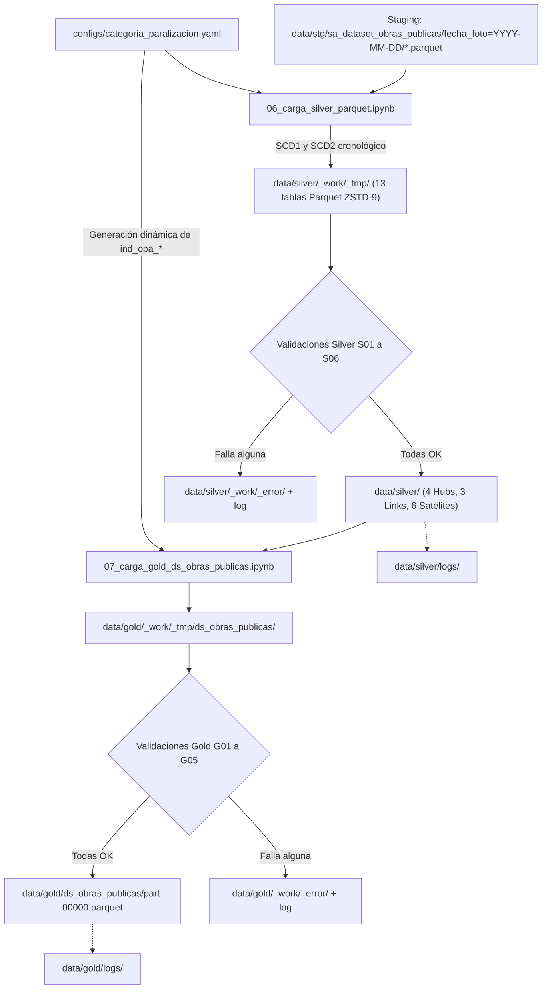

# Ampliación de Capa Silver (Data Vault) y Dataset POC Gold (`ds_obras_publicas`)

*   **Author:** ycalderonf@uni.pe
*   **Status:** Approved
*   **Date:** 2026-11-19

--------------------------------------------------------------------------------

## Overview

Este documento define el diseño para ampliar la capa Silver ([data/silver](file:///c:/ws/formacion/uni-mia/mia-tesis-opa/data/silver)) bajo un modelo Data Vault 2.0 estricto y construir, a partir exclusivamente de Silver, el dataset plano de prueba de concepto (POC) `ds_obras_publicas` en la capa Gold ([data/gold](file:///c:/ws/formacion/uni-mia/mia-tesis-opa/data/gold)).

El alcance abarca dos componentes integrados:

1. **Ampliación de la capa Silver (`data/silver/`) de 6 a 13 tablas Parquet**:
   - **4 Hubs (SCD Tipo 1 con actualización `COALESCE(nuevo_valor, valor_actual)`)**:
     - `hub_obra_publica`: ya existente (`codigo_infobras` + 7 atributos de dominio `obra` + `first_seen_date`, `fecha_foto`).
     - `hub_entidad`: tabla maestra de entidades (`codigo_entidad`, `nivel_gobierno`, `sector_entidad`, `first_seen_date`, `fecha_foto`).
     - `hub_proyecto`: tabla maestra de proyectos de inversión (`codigo_unico`, `tipo_formato`, `first_seen_date`, `fecha_foto`).
     - `hub_contratista`: tabla maestra de contratistas unificando `ruc_1` y `ruc_2` (`ruc`, `razon_social_empresa_consorcio`, `first_seen_date`, `fecha_foto`).
   - **3 Links (SCD Tipo 2 con `start_date`, `end_date = NULL`, `fecha_foto`)**:
     - `link_obra_entidad`: enlaza `codigo_infobras` con `codigo_entidad`.
     - `link_obra_proyecto`: enlaza `codigo_infobras` con `codigo_unico` válido (`!= '0'`).
     - `link_obra_contratista`: unifica ejecución (`ruc_1`) y supervisión (`ruc_2`) mediante el campo `rol IN ('EJECUCION', 'SUPERVISION')`, versionando la relación por `(codigo_infobras, rol)`.
   - **6 Satélites**:
     - `sat_obra_paralizacion` (SCD Tipo 2): incorpora el nuevo campo `categoria_paralizacion` resuelto desde una variable de mapeo configurable con 7 categorías (`CONTRACTUAL`, `FINANCIERO`, `OPERATIVO`, `EXTERNO`, `TECNICO`, `GOBERNANZA`, `NO_CLASIFICADO`), asignando `NULL` cuando `flg_existe_paralizacion = FALSE` y `'NO_CLASIFICADO'` como respaldo para causales vacías o no mapeadas cuando `flg_existe_paralizacion = TRUE`.
     - `sat_obra_estado_ejecucion` (SCD Tipo 2): versiona `estado_ejecucion`.
     - `sat_obra_ubigeo` (SCD Tipo 1): registra `departamento`, `provincia` y `distrito` por `codigo_infobras`.
     - `sat_obra_expediente_tecnico` (SCD Tipo 2): versiona `fecha_aprobacion_expediente`, `monto_aprobacion_et` y `monto_aprobado_soles` por `codigo_infobras`.
     - `sat_proyecto` (SCD Tipo 2): versiona `n_obras_relacionadas_proyecto` por `codigo_unico`.
     - `sat_link_obra_contratista` (SCD Tipo 2): versiona `monto_contrato_soles` por la clave compuesta `(codigo_infobras, rol, ruc)` (`monto_contrato_soles_1` para `EJECUCION` y `monto_contrato_soles_2` para `SUPERVISION`).

2. **Dataset POC en capa Gold (`data/gold/ds_obras_publicas/part-00000.parquet`)**:
   - Tabla plana desnormalizada con **1 registro por `codigo_infobras`** (`204,493` obras desde `2023-07-11`), construida leyendo exclusivamente desde `data/silver/`.
   - Incluye las 27 columnas de negocio (las 23 columnas base excluyendo temporalmente `marco`, más `razon_social_empresa_consorcio_eje`, `monto_contrato_soles_eje`, `razon_social_empresa_consorcio_sup` y `monto_contrato_soles_sup`), el indicador `flg_existe_paralizacion`, el último motivo de paralización (`causal_paralizacion_ultimo`), los 7 contadores acumulados por categoría de evento (`ind_opa_contractual`, `ind_opa_financiero`, `ind_opa_operativo`, `ind_opa_externo`, `ind_opa_tecnico`, `ind_opa_gobernanza`, `ind_opa_no_clasificado`) y `fecha_foto` (37 columnas totales).

## The Problem

La implementación inicial de la capa Silver (6 tablas) no cubre los requerimientos necesarios para construir el dataset analítico Gold ni permite agrupar las paralizaciones sin repetir lógica manual:

1. **Ausencia de categorización normalizada de paralizaciones en Silver**: en `sat_obra_paralizacion` existen 28 descripciones distintas de `causal_paralizacion` (las 27 definidas en el mapeo más `'Falta de autorización de dinero por preliquidaciones mensuales observadas'` con 10 versiones registradas). Sin un campo `categoria_paralizacion` calculado mediante una variable de mapeo configurable en Silver, cada consumidor debe codificar reglas manuales y corre el riesgo de clasificar filas donde `flg_existe_paralizacion = FALSE` como `'NO_CLASIFICADO'`, contaminando `ind_opa_no_clasificado`.
2. **Falta de 11 atributos requeridos para Gold en Silver**: del diccionario solicitado para `ds_obras_publicas`, 11 columnas existentes en Staging (`nivel_gobierno`, `sector_entidad`, `tipo_formato`, `n_obras_relacionadas_proyecto`, `departamento`, `provincia`, `distrito`, `fecha_aprobacion_expediente`, `monto_aprobacion_et`, `monto_aprobado_soles`, `ruc_2`) junto con `razon_social_empresa_consorcio` y `monto_contrato_soles` aún no residen en `data/silver/`.
3. **Conflicto de cardinalidad al modelar contratistas de ejecución y supervisión**: en el análisis sobre Staging (corte `2026-04-01`), se identificaron `47,138` RUCs únicos al unir `ruc_1` y `ruc_2`. De ellos, `12,621` empresas participan en más de una obra, `9,983` registran múltiples `monto_contrato_soles` distintos y `1,588` actúan tanto en rol `'EJECUCION'` como en `'SUPERVISION'`. Almacenar `rol` o `monto_contrato_soles` en `hub_contratista` sobrescribiría contratos de distintas obras. Separar `hub_contratista` (único por `ruc`), `link_obra_contratista` (con `rol`) y `sat_link_obra_contratista` (`monto_contrato_soles`) respeta la cardinalidad real.
4. **Necesidad de una vista plana POC por obra en Gold**: el análisis exploratorio y la preparación inicial de características requieren un dataset consolidado de 1 fila por `codigo_infobras` (`ds_obras_publicas`) con el conteo histórico de paralizaciones por categoría y sin aplicar aún filtros de población por `fecha_inicio_obra`.

## Goals

* Incorporar `categoria_paralizacion` en `sat_obra_paralizacion` mediante una variable de mapeo configurable (sin codificación rígida en SQL), asignando `'NO_CLASIFICADO'` cuando `flg_existe_paralizacion = TRUE` y la causal está vacía o no existe en el mapa, y `NULL` cuando `flg_existe_paralizacion = FALSE`.
* Ampliar `data/silver/` de 6 a **13 tablas Parquet** bajo Data Vault 2.0 estricto (`4` Hubs, `3` Links y `6` Satélites), manteniendo los modos `PRUEBA`, `COMPLETA` e `INCREMENTAL` y las validaciones bloqueantes `S01`–`S06`.
* Generar `data/gold/ds_obras_publicas/part-00000.parquet` leyendo únicamente desde `data/silver/`, garantizando exactamente 1 fila por `codigo_infobras` (`204,493` filas) y sus 37 columnas (las 27 columnas de negocio incluyendo razón social y monto contractual de ejecución/supervisión, `flg_existe_paralizacion`, `causal_paralizacion_ultimo`, los 7 indicadores `ind_opa_<categoria>` y `fecha_foto`).

## Non-Goals

* Incluir el campo `marco` del Banco de Inversiones en Silver o Gold (diferido explícitamente por el autor para una iteración posterior).
* Filtrar `ds_obras_publicas` por `fecha_inicio_obra`, `modalidad_ejecucion_obra`, `nivel_gobierno` o `codigo_unico`; todos los filtros de población y horizonte se aplicarán posteriormente en la ingeniería de características.
* Calcular variables objetivo *point-in-time* ($Y_i^{(\tau)}$, $R_i^{(\tau)}$) o tasas históricas suavizadas en $t_{0i}$ dentro de `ds_obras_publicas`; este dataset POC resume la historia conocida por obra, mientras que el corte libre de fuga temporal para entrenamiento se construirá en etapas posteriores usando los satélites SCD Tipo 2 de Silver.
* Integrar fuentes externas adicionales (`INCO`, `IGEIP`, `OECE`) en esta iteración.

## Open Questions

* Ninguna pregunta abierta para la definición de alcance y objetivos.

## Critical User Journeys (CUJs)

### CUJ 1: Actualización y ampliación de capa Silver (13 tablas Data Vault + `categoria_paralizacion`)

* **Given**: Existen las 37 particiones Hive en Staging (`fecha_foto >= 2023-07-11`) y la variable de mapeo configurable de causales hacia categorías de paralización.
* **When**: Se ejecuta `06_carga_silver_parquet.ipynb` en modo `COMPLETA` o `INCREMENTAL`.
* **Then**: Las 13 tablas Parquet en `data/silver/` se generan y validan (`S01`–`S06`) con unicidad de claves en los 4 Hubs, sin solapamientos temporales en Links y Satélites SCD2, separando correctamente contratos por `(codigo_infobras, rol, ruc)` y asignando `categoria_paralizacion` en `sat_obra_paralizacion`.

### CUJ 2: Construcción del dataset POC Gold `ds_obras_publicas`

* **Given**: Las 13 tablas de `data/silver/` están pobladas y validadas.
* **When**: Se ejecuta el proceso de construcción de capa Gold hacia `data/gold/ds_obras_publicas/part-00000.parquet`.
* **Then**: Se genera una tabla plana con exactamente 1 fila por `codigo_infobras` (`204,493` filas) y 37 columnas, conteniendo las 27 columnas de negocio (con la última relación abierta de `link_obra_contratista`, `hub_contratista` y `sat_link_obra_contratista` para ejecución y supervisión), `flg_existe_paralizacion`, `causal_paralizacion_ultimo`, los 7 contadores `ind_opa_<categoria>` y `fecha_foto`.

## Technical Plan (Architecture)

### 1. Arquitectura Medallion y flujo de datos

El pipeline conecta tres capas en DuckDB y Parquet bajo ejecución idempotente con escritura temporal aislada y promoción atómica:

### 2. Configuración externa de categorización (`configs/categoria_paralizacion.yaml`)

Para evitar codificación rígida de reglas de negocio en SQL o en notebooks, el mapeo de `causal_paralizacion` → `categoria_paralizacion` se define en `configs/categoria_paralizacion.yaml`:

*   **Estructura del archivo YAML**:
    *   `default_category`: `'NO_CLASIFICADO'`
    *   `categories`: lista ordenada de categorías válidas (`CONTRACTUAL`, `FINANCIERO`, `OPERATIVO`, `EXTERNO`, `TECNICO`, `GOBERNANZA`, `NO_CLASIFICADO`).
    *   `mapping`: diccionario clave-valor con las 27 descripciones de `causal_paralizacion` (incluyendo las 7 causales de `CONTRACTUAL`, 3 de `FINANCIERO`, 6 de `OPERATIVO`, 4 de `EXTERNO`, 3 de `TECNICO`, 1 de `GOBERNANZA` y 3 de `NO_CLASIFICADO`, donde `(vacío)` se maneja por `IS NULL`).
*   **Contrato de resolución en DuckDB**:
    *   Al inicio de `06_carga_silver_parquet.ipynb` se carga el YAML en una variable Python y se registra como tabla temporal `_map_categoria_paralizacion(causal_norm VARCHAR, categoria_paralizacion VARCHAR)`.
    *   Durante `cargar_foto_limpia`, el cruce contra `_map_categoria_paralizacion` se realiza por `lower(trim(causal_paralizacion))`.
    *   Si `flg_existe_paralizacion = FALSE`, `categoria_paralizacion` toma `NULL` (evitando contaminar `NO_CLASIFICADO`).
    *   Si `flg_existe_paralizacion = TRUE`, toma `COALESCE(m.categoria_paralizacion, default_category)` —clasificando como `'NO_CLASIFICADO'` tanto causales `NULL`/vacías como causales nuevas no mapeadas (por ejemplo, `'Falta de autorización de dinero por preliquidaciones mensuales observadas'`).

### 3. Esquema físico de las 13 tablas en `data/silver/`

Todas las tablas se escriben como `data/silver/<tabla>/part-00000.parquet` con compresión `ZSTD` nivel 9.

#### A. Hubs (4 tablas — SCD Tipo 1 con `COALESCE(nuevo_valor, valor_actual)`)

| Tabla | Clave única (`order_by`) | Columnas de negocio | Auditoría | Fuente y regla de deduplicación por foto |
|---|---|---|---|---|
| `hub_obra_publica` | `codigo_infobras` (`VARCHAR`) | `modalidad_ejecucion_obra`, `naturaleza_obra`, `tipo_obra_nivel_1..3`, `fecha_inicio_obra`, `fecha_finalizacion_real` | `first_seen_date`, `fecha_foto` | Desde `foto_actual` (ya deduplicada por Regla 1). |
| `hub_entidad` | `codigo_entidad` (`VARCHAR`) | `nivel_gobierno` (`VARCHAR`), `sector_entidad` (`VARCHAR`) | `first_seen_date`, `fecha_foto` | Agrupado por `codigo_entidad` válido tomando la moda determinista (`COUNT(*) DESC`, desempate alfabético `ASC`). |
| `hub_proyecto` | `codigo_unico` (`VARCHAR`) | `tipo_formato` (`VARCHAR`) | `first_seen_date`, `fecha_foto` | Agrupado por `codigo_unico IS NOT NULL AND trim(codigo_unico) NOT IN ('', '0')` tomando la moda determinista de `tipo_formato` (`COUNT(*) DESC`, desempate `ASC`). |
| `hub_contratista` | `ruc` (`VARCHAR`) | `razon_social_empresa_consorcio` (`VARCHAR`) | `first_seen_date`, `fecha_foto` | Unifica `(ruc_1, razon_social_empresa_consorcio_1)` y `(ruc_2, razon_social_empresa_consorcio_2)` con `ruc` válido agrupando por `ruc` con moda determinista (`COUNT(*) DESC`, desempate `ASC`). |

#### B. Links (3 tablas — SCD Tipo 2 con `start_date`, `end_date = NULL`, `fecha_foto`)

| Tabla | Clave de seguimiento (`key_cols`) | Columna enlazada | Condición de presencia en foto | Orden físico |
|---|---|---|---|---|
| `link_obra_entidad` | `codigo_infobras` | `codigo_entidad` (`VARCHAR`) | `codigo_entidad IS NOT NULL` | `codigo_infobras, start_date` |
| `link_obra_proyecto` | `codigo_infobras` | `codigo_unico` (`VARCHAR`) | `codigo_unico IS NOT NULL AND trim(codigo_unico) NOT IN ('', '0')` | `codigo_infobras, start_date` |
| `link_obra_contratista` | `codigo_infobras, rol` | `ruc` (`VARCHAR`) | Unión de `rol='EJECUCION'` (`ruc_1 IS NOT NULL`) y `rol='SUPERVISION'` (`ruc_2 IS NOT NULL`) | `codigo_infobras, rol, start_date` |

#### C. Satélites (6 tablas)

| Tabla | Modelo y clave (`key_cols`) | Columnas de seguimiento / negocio | Vigencia / Auditoría | Regla de origen por foto |
|---|---|---|---|---|
| `sat_obra_paralizacion` | SCD2 (`codigo_infobras`) | `flg_existe_paralizacion` (`BOOLEAN`), `causal_paralizacion` (`VARCHAR`), `categoria_paralizacion` (`VARCHAR`), `fecha_paralizacion` (`DATE`) | `start_date`, `end_date`, `fecha_foto` | Aplica Regla 3 y cruce con `configs/categoria_paralizacion.yaml`. |
| `sat_obra_estado_ejecucion` | SCD2 (`codigo_infobras`) | `estado_ejecucion` (`VARCHAR`) | `start_date`, `end_date`, `fecha_foto` | `estado_ejecucion IS NOT NULL`. |
| `sat_obra_ubigeo` | SCD1 (`codigo_infobras`) | `departamento` (`VARCHAR`), `provincia` (`VARCHAR`), `distrito` (`VARCHAR`) | `first_seen_date`, `fecha_foto` | Desde `foto_actual` usando `COALESCE(nuevo, actual)`. |
| `sat_obra_expediente_tecnico` | SCD2 (`codigo_infobras`) | `fecha_aprobacion_expediente` (`DATE`), `monto_aprobacion_et` (`DOUBLE`), `monto_aprobado_soles` (`DOUBLE`) | `start_date`, `end_date`, `fecha_foto` | Inserta/versiona cuando al menos uno de los 3 campos ET no es nulo. |
| `sat_proyecto` | SCD2 (`codigo_unico`) | `n_obras_relacionadas_proyecto` (`INTEGER`) | `start_date`, `end_date`, `fecha_foto` | Agrupado por `codigo_unico` válido usando `MAX(n_obras_relacionadas_proyecto)` no nulo. |
| `sat_link_obra_contratista` | SCD2 (`codigo_infobras, rol, ruc`) | `monto_contrato_soles` (`DOUBLE`) | `start_date`, `end_date`, `fecha_foto` | Unión de `EJECUCION` (`ruc_1`, `monto_contrato_soles_1`) y `SUPERVISION` (`ruc_2`, `monto_contrato_soles_2`). |

### 4. Generalización del motor Silver y validaciones (`S01`–`S06`)

*   **Motor unificado SCD1 y SCD2 con claves compuestas**:
    *   `actualizar_tabla_scd1(con, nombre_tabla, key_col, attr_cols, fuente_sql, fecha_foto)`: reemplaza la lógica específica anterior para unificar las 5 tablas SCD1 (`hub_obra_publica`, `hub_entidad`, `hub_proyecto`, `hub_contratista`, `sat_obra_ubigeo`), preservando valores previos con `COALESCE(nuevo, actual)` e insertando nuevas claves con `first_seen_date = fecha_foto`.
    *   `actualizar_tabla_scd2(con, nombre_tabla, key_cols, cols_track, fuente_sql, fecha_foto)`: generaliza las uniones `USING (...)` para soportar llaves de 1, 2 o 3 columnas (`["codigo_infobras"]`, `["codigo_unico"]`, `["codigo_infobras", "rol"]`, `["codigo_infobras", "rol", "ruc"]`) manteniendo la misma lógica de 4 casos (`nueva clave`, `sin cambios`, `cambio cerrando end_date = T` y `ausencia sin modificar versión abierta`).
    *   En `cargar_foto_limpia`, se amplía la proyección de Staging a las 33 columnas necesarias (30 de atributos/claves y 3 de deduplicación) para alimentar los 4 Hubs, 3 Links y 6 Satélites manteniendo *column pruning* en la lectura Parquet.
*   **Validaciones bloqueantes en Silver (`S01`–`S06`) antes de promover `_work/`**:
    *   `S01`: Unicidad 100 % y 0 nulos en la clave primaria de las 5 tablas SCD1 (`hub_obra_publica`, `hub_entidad`, `hub_proyecto`, `hub_contratista`, `sat_obra_ubigeo`).
    *   `S02`: A lo sumo 1 versión abierta (`end_date IS NULL`) por `key_cols` en las 8 tablas SCD2 (`3` Links + `5` Satélites).
    *   `S03`: Integridad temporal en las 8 tablas SCD2 (`start_date <= fecha_foto`, `end_date IS NULL OR start_date < end_date`, cero solapamientos por `key_cols`).
    *   `S04`: Integridad referencial cruzada y claves válidas: todo `codigo_infobras` existe en `hub_obra_publica`; `link_obra_entidad.codigo_entidad` existe en `hub_entidad`; `link_obra_proyecto.codigo_unico` y `sat_proyecto.codigo_unico` existen en `hub_proyecto` (sin `'0'`); `link_obra_contratista.ruc` existe en `hub_contratista` con `rol IN ('EJECUCION', 'SUPERVISION')`; todo `(codigo_infobras, rol, ruc)` de `sat_link_obra_contratista` existe en `link_obra_contratista`.
    *   `S05`: Consistencia de Regla 3 y categorización en `sat_obra_paralizacion`: 0 filas con `flg_existe_paralizacion = FALSE` y (`causal_paralizacion IS NOT NULL` OR `fecha_paralizacion IS NOT NULL` OR `categoria_paralizacion IS NOT NULL`); 0 filas con `flg_existe_paralizacion = TRUE` cuyo `categoria_paralizacion` sea `NULL` o no pertenezca a `categories` en `configs/categoria_paralizacion.yaml`.
    *   `S06`: Paridad exacta de esquema, tipos DuckDB/Parquet y conteo de filas respecto a memoria en las 13 tablas.

### 5. Esquema físico y lógica de ensamblado de Gold (`data/gold/ds_obras_publicas/part-00000.parquet`)

El notebook `07_carga_gold_ds_obras_publicas.ipynb` lee exclusivamente las tablas de `data/silver/` (sin acceso a `data/stg/`) y genera un archivo Parquet ordenado por `codigo_infobras` con **37 columnas** y exactamente **1 fila por obra** (`204,493` filas):

| # | Columna en `ds_obras_publicas` | Tipo | Tabla Silver origen | Regla de obtención / agregación |
|---|---|---|---|---|
| 1 | `codigo_infobras` | `VARCHAR` | `hub_obra_publica` | Clave primaria (todas las obras desde `2023-07-11`). |
| 2 | `codigo_entidad` | `VARCHAR` | `link_obra_entidad` | `WHERE end_date IS NULL` (`LEFT JOIN`). |
| 3 | `nivel_gobierno` | `VARCHAR` | `hub_entidad` | `LEFT JOIN` vía `codigo_entidad` vigente. |
| 4 | `sector_entidad` | `VARCHAR` | `hub_entidad` | `LEFT JOIN` vía `codigo_entidad` vigente. |
| 5 | `codigo_unico` | `VARCHAR` | `link_obra_proyecto` | `WHERE end_date IS NULL` (`LEFT JOIN`). |
| 6 | `tipo_formato` | `VARCHAR` | `hub_proyecto` | `LEFT JOIN` vía `codigo_unico` vigente. |
| 7 | `n_obras_relacionadas_proyecto` | `INTEGER` | `sat_proyecto` | `WHERE end_date IS NULL` vía `codigo_unico` vigente. |
| 8 | `modalidad_ejecucion_obra` | `VARCHAR` | `hub_obra_publica` | Directo del Hub. |
| 9 | `estado_ejecucion` | `VARCHAR` | `sat_obra_estado_ejecucion` | `WHERE end_date IS NULL`. |
| 10 | `naturaleza_obra` | `VARCHAR` | `hub_obra_publica` | Directo del Hub. |
| 11 | `tipo_obra_nivel_1` | `VARCHAR` | `hub_obra_publica` | Directo del Hub. |
| 12 | `tipo_obra_nivel_2` | `VARCHAR` | `hub_obra_publica` | Directo del Hub. |
| 13 | `tipo_obra_nivel_3` | `VARCHAR` | `hub_obra_publica` | Directo del Hub. |
| 14 | `fecha_inicio_obra` | `DATE` | `hub_obra_publica` | Directo del Hub. |
| 15 | `fecha_finalizacion_real` | `DATE` | `hub_obra_publica` | Directo del Hub. |
| 16 | `departamento` | `VARCHAR` | `sat_obra_ubigeo` | Directo (`LEFT JOIN` por `codigo_infobras`). |
| 17 | `provincia` | `VARCHAR` | `sat_obra_ubigeo` | Directo (`LEFT JOIN` por `codigo_infobras`). |
| 18 | `distrito` | `VARCHAR` | `sat_obra_ubigeo` | Directo (`LEFT JOIN` por `codigo_infobras`). |
| 19 | `fecha_aprobacion_expediente` | `DATE` | `sat_obra_expediente_tecnico` | `WHERE end_date IS NULL` (`LEFT JOIN`). |
| 20 | `monto_aprobacion_et` | `DOUBLE` | `sat_obra_expediente_tecnico` | `WHERE end_date IS NULL` (`LEFT JOIN`). |
| 21 | `monto_aprobado_soles` | `DOUBLE` | `sat_obra_expediente_tecnico` | `WHERE end_date IS NULL` (`LEFT JOIN`). |
| 22 | `ruc_1` | `VARCHAR` | `link_obra_contratista` | `WHERE end_date IS NULL AND rol = 'EJECUCION'`. |
| 23 | `razon_social_empresa_consorcio_eje` | `VARCHAR` | `hub_contratista` | `LEFT JOIN` vía `ruc_1` (`link_obra_contratista` con `rol = 'EJECUCION' AND end_date IS NULL`). |
| 24 | `monto_contrato_soles_eje` | `DOUBLE` | `sat_link_obra_contratista` | `LEFT JOIN` por `(codigo_infobras, rol = 'EJECUCION', ruc = ruc_1)` con `end_date IS NULL`. |
| 25 | `ruc_2` | `VARCHAR` | `link_obra_contratista` | `WHERE end_date IS NULL AND rol = 'SUPERVISION'`. |
| 26 | `razon_social_empresa_consorcio_sup` | `VARCHAR` | `hub_contratista` | `LEFT JOIN` vía `ruc_2` (`link_obra_contratista` con `rol = 'SUPERVISION' AND end_date IS NULL`). |
| 27 | `monto_contrato_soles_sup` | `DOUBLE` | `sat_link_obra_contratista` | `LEFT JOIN` por `(codigo_infobras, rol = 'SUPERVISION', ruc = ruc_2)` con `end_date IS NULL`. |
| 28 | `flg_existe_paralizacion` | `BOOLEAN` | `sat_obra_paralizacion` | `COALESCE(BOOL_OR(flg_existe_paralizacion), FALSE)` sobre todo el historial de la obra (`TRUE` si ocurrió al menos un evento de paralización, `FALSE` en caso contrario; equivale a `1`/`0` al convertir a numérico). |
| 29 | `causal_paralizacion_ultimo` | `VARCHAR` | `sat_obra_paralizacion` | `ARG_MAX(causal_paralizacion, {'s': start_date, 'f': fecha_foto}) FILTER (WHERE flg_existe_paralizacion)` por obra. |
| 30–36 | `ind_opa_contractual`, `ind_opa_financiero`, `ind_opa_operativo`, `ind_opa_externo`, `ind_opa_tecnico`, `ind_opa_gobernanza`, `ind_opa_no_clasificado` | `INTEGER` | `sat_obra_paralizacion` | Generados dinámicamente desde `categories` en `configs/categoria_paralizacion.yaml`: `COALESCE(COUNT(*) FILTER (WHERE flg_existe_paralizacion AND categoria_paralizacion = '<CAT>'), 0)::INTEGER`. Cada versión donde `flg_existe_paralizacion = TRUE` representa 1 episodio distinto registrado. |
| 37 | `fecha_foto` | `DATE` | `hub_obra_publica` | Última `fecha_foto` en la que apareció la obra en Silver. |

*   **Validaciones bloqueantes en Gold (`G01`–`G05`) antes de promover `data/gold/_work/`**:
    *   `G01`: 1 fila por `codigo_infobras` (`COUNT(*) = COUNT(DISTINCT codigo_infobras) = COUNT(hub_obra_publica)`).
    *   `G02`: Esquema y tipos exactos de las 37 columnas en `ds_obras_publicas/part-00000.parquet`.
    *   `G03`: Cero nulos y cero valores `< 0` en los 7 contadores `ind_opa_*`.
    *   `G04`: Conservación total de eventos: `SUM(ind_opa_contractual + ... + ind_opa_no_clasificado)` en Gold es igual a `COUNT(*) FILTER (WHERE flg_existe_paralizacion)` en `sat_obra_paralizacion`.
    *   `G05`: Consistencia de indicador y última causal: `flg_existe_paralizacion IS NOT NULL`, `flg_existe_paralizacion = ((ind_opa_contractual + ... + ind_opa_no_clasificado) > 0)`, y toda obra donde `flg_existe_paralizacion = FALSE` tiene `causal_paralizacion_ultimo IS NULL`.

## Alternatives Considered

### Alternative A: Construir el POC Gold combinando Silver (6 tablas) + Staging (11 columnas faltantes)

*   **Pros**: Menor trabajo inicial al modificar `06_carga_silver_parquet.ipynb` únicamente para agregar `categoria_paralizacion`.
*   **Cons**: Acopla la capa Gold directamente a los archivos Parquet crudos de Staging, duplicando reglas de deduplicación y actualización si luego se construyen otros datasets analíticos.
*   **Reason for Rejection**: Rejected by author: se optó por ampliar Silver a 13 tablas Data Vault para que Gold consuma 100 % desde Silver manteniendo el aislamiento de capas.

### Alternative B: Incluir el campo `marco` en esta iteración (derivado de `tipo_formato` o cruzado desde PostgreSQL)

*   **Pros**: Completa desde el POC las 24 columnas originales solicitadas en la tabla de definición.
*   **Cons**: En Staging, `tipo_formato` es `NULL` en `105,622` de `191,180` obras (corte `2026-04-01`), dejando más de la mitad del universo sin `marco`, mientras que el cruce con el Banco de Inversiones en PostgreSQL introduce una dependencia externa aún por evaluar.
*   **Reason for Rejection**: Rejected by author: el campo `marco` se difiere explícitamente para una iteración posterior.

### Alternative C: Almacenar los nuevos atributos de proyecto y expediente técnico en SCD Tipo 1 (o en un único `sat_obra_detalle`)

*   **Pros**: Reduce la cantidad de tablas y produce archivos ligeramente más compactos en Silver.
*   **Cons**: Sobrescribe valores históricos de atributos altamente cambiantes (`n_obras_relacionadas_proyecto` cambia en `184,133` obras y `monto_aprobado_soles` cambia en `7,087` obras), impidiendo reconstruir el estado existente en la fecha de inicio de obra $t_{0i}$ para el modelado sin fuga temporal.
*   **Reason for Rejection**: Rejected by author: se eligió separar por dominio con `hub_proyecto` + `sat_proyecto` (SCD Tipo 2) y `sat_obra_expediente_tecnico` (SCD Tipo 2).

### Alternative D: Guardar `rol` y `monto_contrato_soles` dentro de `hub_contratista` o dentro de `link_obra_contratista`

*   **Pros**: Reduce el número de tablas del dominio contratista de 3 a 1 o 2.
*   **Cons**: Sobre `47,138` RUCs únicos (`2026-04-01`), `12,621` empresas participan en múltiples obras, `9,983` registran múltiples `monto_contrato_soles` distintos y `1,588` actúan tanto en ejecución como en supervisión; incluirlos en `hub_contratista` sobrescribiría contratos de distintas obras. Incluir `monto_contrato_soles` en `link_obra_contratista` cerraría la relación del contratista ante una adenda de monto sin cambio de RUC.
*   **Reason for Rejection**: Rejected by author: se adoptó Data Vault 2.0 estricto con `hub_contratista` (`ruc`), `link_obra_contratista` (`codigo_infobras`, `rol`, `ruc`) y `sat_link_obra_contratista` (`monto_contrato_soles`).

### Alternative E: Codificar las 27 causales en `SQL CASE` rígido o asignar `'NO_CLASIFICADO'` cuando `flg_existe_paralizacion = FALSE`

*   **Pros**: Evita crear un archivo de configuración YAML adicional en `configs/`.
*   **Cons**: Duplicar un `CASE` rígido en Silver y Gold exige editar ambos notebooks ante cualquier nueva causal CGR, y clasificar filas no paralizadas como `'NO_CLASIFICADO'` generaría `ind_opa_no_clasificado >= 1` en obras jamás paralizadas.
*   **Reason for Rejection**: Rejected by author: se externaliza el mapeo en `configs/categoria_paralizacion.yaml` y se fija `categoria_paralizacion = NULL` cuando `flg_existe_paralizacion = FALSE`.

--------------------------------------------------------------------------------

## Non-Functional Requirements

*   **Performance & Storage**: La carga Silver de 13 tablas sobre las 37 particiones se ejecuta en DuckDB en memoria (< 90 s estimados) y la generación de Gold `ds_obras_publicas` en < 5 s, almacenando todo en Parquet con compresión `ZSTD` nivel 9.
*   **Atomicity & Rollback**: Ambos pipelines escriben primero en directorios temporales aislados (`data/silver/_work/` y `data/gold/_work/`), ejecutan validaciones bloqueantes (`S01`–`S06`, `G01`–`G05`) y realizan promoción atómica con respaldo `_old`; ante cualquier falla, los archivos previos permanecen intactos.

--------------------------------------------------------------------------------

### Additional Resources

*   Diseño base de capa Silver: [carga_silver_obras_publicas.md](file:///c:/ws/formacion/uni-mia/mia-tesis-opa/docs/designs/carga_silver_obras_publicas.md)
*   Reglas de negocio de capa Silver: [silver_layer_rules.md](file:///c:/ws/formacion/uni-mia/mia-tesis-opa/docs/dataflow/silver_layer_rules.md)
*   Diccionario de datos: [data_dictionary.md](file:///c:/ws/formacion/uni-mia/mia-tesis-opa/docs/data_dictionary.md)
*   Plan de tesis (formulación matemática): [main.typ](file:///c:/ws/formacion/uni-mia/mia-tesis-opa/tesis/plan/main.typ)

### Future Improvements

*   Integrar el campo `marco` y atributos complementarios del Banco de Inversiones (MEF) en `hub_proyecto`.
*   Derivar desde los satélites SCD Tipo 2 de Silver el dataset *point-in-time* congelado en la fecha de inicio de obra $t_{0i}$ con horizonte $\tau$ y observabilidad $R_i^{(\tau)}$ para el entrenamiento supervisado libre de fuga temporal.

## Detailed Implementation Plan

### Target Files to Create/Modify

#### 1. `./configs/categoria_paralizacion.yaml` (Create)

*   **Type / Scope**: Archivo de configuración YAML de reglas de categorización de paralizaciones.
*   **Rationale**: Externalizar el mapeo `causal_paralizacion -> categoria_paralizacion` como única fuente de verdad compartida entre Silver y Gold, eliminando expresiones `CASE` rígidas en código.
*   **Proposed Changes**: Definir `default_category: "NO_CLASIFICADO"`, `categories: ["CONTRACTUAL", "FINANCIERO", "OPERATIVO", "EXTERNO", "TECNICO", "GOBERNANZA", "NO_CLASIFICADO"]` y `mapping` con las 27 entradas de `causal_paralizacion` aprobadas.

#### 2. `./docs/dataflow/silver_layer_rules.md` (Modify)

*   **Type / Scope**: Documentación funcional de reglas de negocio de la capa Silver.
*   **Rationale**: Mantener sincronizadas las reglas documentadas con la ampliación a 13 tablas Data Vault 2.0 y la nueva columna `categoria_paralizacion`.
*   **Proposed Changes**:
    *   Actualizar la Regla 7 indicando que `link_obra_contratista` unifica ejecución (`ruc_1`) y supervisión (`ruc_2`) mediante el campo `rol IN ('EJECUCION', 'SUPERVISION')`.
    *   Agregar la Regla 8 para la resolución configurable de `categoria_paralizacion` en `sat_obra_paralizacion`: `NULL` cuando `flg_existe_paralizacion = FALSE`, y mapeo normalizado desde `configs/categoria_paralizacion.yaml` (con respaldo `'NO_CLASIFICADO'`) cuando `flg_existe_paralizacion = TRUE`.
    *   Agregar la Regla 9 describiendo las entidades adicionales Data Vault 2.0 (`hub_entidad`, `hub_proyecto`, `hub_contratista`, `sat_obra_ubigeo`, `sat_obra_expediente_tecnico`, `sat_proyecto` y `sat_link_obra_contratista`).

#### 3. `./etl/06_carga_silver_parquet.ipynb` (Modify)

*   **Type / Scope**: Notebook ETL cronológico Staging → Silver en DuckDB y Parquet.
*   **Rationale**: Expandir la carga Silver de 6 a 13 tablas Data Vault 2.0 e incorporar `categoria_paralizacion` en `sat_obra_paralizacion` manteniendo los modos `PRUEBA`, `COMPLETA` e `INCREMENTAL`.
*   **Proposed Changes**:
    1.  Cargar `configs/categoria_paralizacion.yaml` en una variable `MAPEO_CATEGORIA_PARALIZACION` y registrar la tabla temporal `_map_categoria_paralizacion(causal_norm, categoria_paralizacion)` en DuckDB.
    2.  Ampliar `SCHEMAS_SILVER` a las 13 tablas (`4` Hubs, `3` Links, `6` Satélites), agregando `categoria_paralizacion VARCHAR` en `sat_obra_paralizacion` y `rol VARCHAR` en `link_obra_contratista`.
    3.  Ampliar `cargar_foto_limpia(con, fecha_foto, ruta_particion)` para proyectar las 33 columnas necesarias de Staging y derivar `categoria_paralizacion` mediante `LEFT JOIN` por `lower(trim(causal_paralizacion))`.
    4.  Generalizar las funciones de actualización de estado a `actualizar_tabla_scd1(con, nombre_tabla, key_col, attr_cols, fuente_sql, fecha_foto) -> dict` (para los 4 Hubs y `sat_obra_ubigeo`) y `actualizar_tabla_scd2(con, nombre_tabla, key_cols, cols_track, fuente_sql, fecha_foto) -> dict` (soportando llaves de 1, 2 o 3 columnas en `link_obra_contratista` y `sat_link_obra_contratista`).
    5.  Extender `validar_tablas_silver(con_mem, rutas_work)` para ejecutar `S01`–`S06` sobre las 13 tablas (unicidad en las 5 tablas SCD1, integridad temporal por `key_cols` en las 8 tablas SCD2, integridad referencial cruzada contra los 4 Hubs y `link_obra_contratista`, y verificación `S05` de `categoria_paralizacion` contra el catálogo YAML).

#### 4. `./etl/07_carga_gold_ds_obras_publicas.ipynb` (Create)

*   **Type / Scope**: Notebook ETL Silver → Gold para el dataset plano POC `data/gold/ds_obras_publicas/part-00000.parquet`.
*   **Rationale**: Consolidar 1 registro por `codigo_infobras` (`204,493` filas, `37` columnas) leyendo 100 % desde `data/silver/` y `configs/categoria_paralizacion.yaml`, con validaciones bloqueantes `G01`–`G05`, promoción atómica desde `data/gold/_work/` y logs en `data/gold/logs/`.
*   **Proposed Changes**: Estructurar el notebook en 8 secciones:
    1.  **Parámetros y rutas**: definir `SILVER_DIR`, `GOLD_DIR`, `GOLD_WORK_DIR`, `GOLD_LOGS_DIR`, `CONFIG_CAT_PATH`, `COMPRESION = "ZSTD"` y `COMPRESION_NIVEL = 9`.
    2.  **Logger y configuración**: configurar `carga_gold_ds_obras_publicas_<RUN_ID>.log` y leer `categories` desde `configs/categoria_paralizacion.yaml`.
    3.  **Ensamblado del dataset (`construir_ds_obras_publicas(con, categorias: list[str]) -> None`)**: construir la tabla en memoria uniendo `hub_obra_publica` con los Hubs, Links (`end_date IS NULL`), Satélites (`end_date IS NULL`), los campos `_eje` y `_sup` (`razon_social_empresa_consorcio_*` de `hub_contratista` y `monto_contrato_soles_*` de `sat_link_obra_contratista`), `flg_existe_paralizacion`, `causal_paralizacion_ultimo` y los 7 contadores dinámicos `ind_opa_<categoria>`.
    4.  **Escritura temporal (`escribir_gold_tmp(con) -> Path`)**: exportar a `data/gold/_work/_tmp/ds_obras_publicas/part-00000.parquet` ordenado por `codigo_infobras`.
    5.  **Validaciones bloqueantes (`validar_gold(con_mem, ruta_tmp, categorias) -> pd.DataFrame`)**: ejecutar `G01`–`G05` sobre el Parquet temporal antes de promover.
    6.  **Promoción atómica (`promover_gold(ruta_tmp) -> Path`)**: promover hacia `data/gold/ds_obras_publicas/part-00000.parquet` con respaldo `_old` y rollback ante errores.
    7.  **Resumen estadístico**: mostrar distribución de `flg_existe_paralizacion`, suma por cada `ind_opa_*` y conteo de nulos por columna.
    8.  **Auditoría de control**: inspeccionar registros sobre `codigo_infobras IN ('501650', '540677', '166922')`.

#### 5. `./docs/datamappings/silver__sa_dataset_obras_publicas__to__dv_obras_publicas.yaml` (Create)

*   **Type / Scope**: Documento YAML de mapeo de datos Staging → Silver (`docs/datamappings/`).
*   **Rationale**: Documentar de forma trazable el linaje columna a columna desde `data/stg/sa_dataset_obras_publicas` hacia las 13 tablas Data Vault 2.0 en `data/silver/`, homologando formato con [stg__dataset_obras_publicas__to__sa_obras_publicas_infobras.yaml](file:///c:/ws/formacion/uni-mia/mia-tesis-opa/docs/datamappings/stg__dataset_obras_publicas__to__sa_obras_publicas_infobras.yaml).
*   **Proposed Changes**: Definir metadatos de origen/destino, modo de carga incremental/completa por partición `fecha_foto`, las reglas de categorización externa mediante `configs/categoria_paralizacion.yaml`, el detalle de las 13 tablas (`4` Hubs, `3` Links, `6` Satélites) con sus claves primarias y estrategias SCD1/SCD2, y las validaciones bloqueantes `S01`–`S06`.

#### 6. `./docs/datamappings/gold__dv_obras_publicas__to__ds_obras_publicas.yaml` (Create)

*   **Type / Scope**: Documento YAML de mapeo de datos Silver → Gold (`docs/datamappings/`).
*   **Rationale**: Documentar el linaje columna a columna desde las 13 tablas de `data/silver/` hacia el dataset plano `data/gold/ds_obras_publicas/part-00000.parquet` (`37` columnas, `1` fila por `codigo_infobras`).
*   **Proposed Changes**: Definir la lectura exclusiva desde Silver, la resolución de relaciones vigentes (`end_date IS NULL`), la derivación de campos `_eje`/`_sup` de contratistas, las agregaciones históricas `flg_existe_paralizacion`, `causal_paralizacion_ultimo` y los contadores dinámicos `ind_opa_*` respaldados por `configs/categoria_paralizacion.yaml`, y las validaciones `G01`–`G05`.

### Verification Plan

*   **Silver `PRUEBA` (primeras 3 fotos desde `2023-07-11`)**:
    *   Ejecutar `06_carga_silver_parquet.ipynb` con `MODO = "PRUEBA"` y `N_FOTOS_PRUEBA = 3` en un directorio temporal.
    *   Confirmar que todas las validaciones `S01`–`S06` sobre las 13 tablas retornan `OK`.
*   **Silver `COMPLETA` (37 particiones, `2023-07-11` a `2026-11-01`)**:
    *   Ejecutar `06_carga_silver_parquet.ipynb` con `MODO = "COMPLETA"` sobre `data/silver/`.
    *   Confirmar `S01`–`S06` en `OK`: `204,493` filas en `hub_obra_publica`, unicidad en `hub_entidad`, `hub_proyecto` y `hub_contratista`, separación de roles `EJECUCION` y `SUPERVISION` en `link_obra_contratista` y `sat_link_obra_contratista`, y cero filas con `flg_existe_paralizacion = FALSE` y `categoria_paralizacion IS NOT NULL` (`S05`).
*   **Silver `INCREMENTAL` (idempotencia y equivalencia)**:
    *   Ejecutar `MODO = "INCREMENTAL"` tras `COMPLETA` y verificar `0` particiones pendientes sin modificar archivos.
    *   Ejecutar prueba controlada cargando 29 fotos en `COMPLETA` (`<= 2026-03-01`) más 8 fotos en `INCREMENTAL` (`2026-04-01` a `2026-11-01`) y verificar con `EXCEPT` en ambas direcciones que las 13 tablas coincidan exactamente con la corrida `COMPLETA` de 37 fotos.
*   **Gold `ds_obras_publicas`**:
    *   Ejecutar `07_carga_gold_ds_obras_publicas.ipynb` leyendo exclusivamente `data/silver/`.
    *   Confirmar que `G01`–`G05` retornan `OK` (`204,493` filas × `37` columnas), que `SUM(ind_opa_*) == COUNT(*) FILTER (WHERE flg_existe_paralizacion)` en `sat_obra_paralizacion` y auditar `501650`, `540677` y `166922` (verificando `flg_existe_paralizacion`, `causal_paralizacion_ultimo`, `ind_opa_*` y columnas `_eje`/`_sup`).

--------------------------------------------------------------------------------

