# Modelo Entidad-Relación — Capa Silver (Data Vault 2.0)

Diagrama Entidad-Relación de las **13 tablas Parquet** implementadas en `data/silver/` bajo el enfoque **Data Vault 2.0** (4 Hubs, 3 Links y 6 Satélites), generado a partir de [06_carga_silver_parquet.ipynb](file:///c:/ws/formacion/uni-mia/mia-tesis-opa/etl/06_carga_silver_parquet.ipynb) y documentado en [silver__sa_dataset_obras_publicas__to__dv_obras_publicas.yaml](file:///c:/ws/formacion/uni-mia/mia-tesis-opa/docs/datamappings/silver__sa_dataset_obras_publicas__to__dv_obras_publicas.yaml).

## Diagrama ER (`Mermaid`)

```mermaid
erDiagram
    hub_obra_publica {
        VARCHAR codigo_infobras PK
        VARCHAR modalidad_ejecucion_obra
        VARCHAR naturaleza_obra
        VARCHAR tipo_obra_nivel_1
        VARCHAR tipo_obra_nivel_2
        VARCHAR tipo_obra_nivel_3
        DATE fecha_inicio_obra
        DATE fecha_finalizacion_real
        DATE first_seen_date
        DATE fecha_foto
    }

    hub_entidad {
        VARCHAR codigo_entidad PK
        VARCHAR nivel_gobierno
        VARCHAR sector_entidad
        DATE first_seen_date
        DATE fecha_foto
    }

    hub_proyecto {
        VARCHAR codigo_unico PK
        VARCHAR tipo_formato
        DATE first_seen_date
        DATE fecha_foto
    }

    hub_contratista {
        VARCHAR ruc PK
        VARCHAR razon_social_empresa_consorcio
        DATE first_seen_date
        DATE fecha_foto
    }

    link_obra_entidad {
        VARCHAR codigo_infobras PK,FK
        VARCHAR codigo_entidad FK
        DATE start_date PK
        DATE end_date
        DATE fecha_foto
    }

    link_obra_proyecto {
        VARCHAR codigo_infobras PK,FK
        VARCHAR codigo_unico FK
        DATE start_date PK
        DATE end_date
        DATE fecha_foto
    }

    link_obra_contratista {
        VARCHAR codigo_infobras PK,FK
        VARCHAR rol PK "EJECUCION | SUPERVISION"
        VARCHAR ruc FK
        DATE start_date PK
        DATE end_date
        DATE fecha_foto
    }

    sat_obra_paralizacion {
        VARCHAR codigo_infobras PK,FK
        BOOLEAN flg_existe_paralizacion
        VARCHAR causal_paralizacion
        VARCHAR categoria_paralizacion "YAML configs/categoria_paralizacion.yaml"
        DATE fecha_paralizacion
        DATE start_date PK
        DATE end_date
        DATE fecha_foto
    }

    sat_obra_estado_ejecucion {
        VARCHAR codigo_infobras PK,FK
        VARCHAR estado_ejecucion
        DATE start_date PK
        DATE end_date
        DATE fecha_foto
    }

    sat_obra_ubigeo {
        VARCHAR codigo_infobras PK,FK
        VARCHAR departamento
        VARCHAR provincia
        VARCHAR distrito
        DATE first_seen_date
        DATE fecha_foto
    }

    sat_obra_expediente_tecnico {
        VARCHAR codigo_infobras PK,FK
        DATE fecha_aprobacion_expediente
        DOUBLE monto_aprobacion_et
        DOUBLE monto_aprobado_soles
        DATE start_date PK
        DATE end_date
        DATE fecha_foto
    }

    sat_proyecto {
        VARCHAR codigo_unico PK,FK
        INTEGER n_obras_relacionadas_proyecto
        DATE start_date PK
        DATE end_date
        DATE fecha_foto
    }

    sat_link_obra_contratista {
        VARCHAR codigo_infobras PK,FK
        VARCHAR rol PK,FK
        VARCHAR ruc PK,FK
        DOUBLE monto_contrato_soles
        DATE start_date PK
        DATE end_date
        DATE fecha_foto
    }

    hub_obra_publica ||--o{ link_obra_entidad : "SCD2 por obra"
    hub_entidad ||--o{ link_obra_entidad : "enlazada por codigo_entidad"

    hub_obra_publica ||--o{ link_obra_proyecto : "SCD2 por obra (codigo_unico != 0)"
    hub_proyecto ||--o{ link_obra_proyecto : "enlazado por codigo_unico"

    hub_obra_publica ||--o{ link_obra_contratista : "SCD2 por (codigo_infobras, rol)"
    hub_contratista ||--o{ link_obra_contratista : "enlazado por ruc"

    hub_obra_publica ||--o{ sat_obra_paralizacion : "SCD2 historial paralizaciones"
    hub_obra_publica ||--o{ sat_obra_estado_ejecucion : "SCD2 historial estado"
    hub_obra_publica ||--|| sat_obra_ubigeo : "SCD1 ubicacion geografica"
    hub_obra_publica ||--o{ sat_obra_expediente_tecnico : "SCD2 montos y aprobacion ET"

    hub_proyecto ||--o{ sat_proyecto : "SCD2 n_obras_relacionadas_proyecto"
    link_obra_contratista ||--o{ sat_link_obra_contratista : "SCD2 monto_contrato_soles por (obra, rol, ruc)"
```

## Convenciones del modelo

| Tipo Data Vault | Tablas | Estrategia SCD | Clave de seguimiento / grano |
|---|---|---|---|
| **Hub (4)** | `hub_obra_publica`, `hub_entidad`, `hub_proyecto`, `hub_contratista` | SCD Tipo 1 (`COALESCE(nuevo, actual)`) | Clave de negocio única (`codigo_infobras`, `codigo_entidad`, `codigo_unico`, `ruc`) |
| **Link (3)** | `link_obra_entidad`, `link_obra_proyecto`, `link_obra_contratista` | SCD Tipo 2 (`start_date`, `end_date = NULL`) | `codigo_infobras` o `(codigo_infobras, rol)` |
| **Satélite SCD1 (1)** | `sat_obra_ubigeo` | SCD Tipo 1 (`COALESCE(nuevo, actual)`) | `codigo_infobras` |
| **Satélite SCD2 (5)** | `sat_obra_paralizacion`, `sat_obra_estado_ejecucion`, `sat_obra_expediente_tecnico`, `sat_proyecto`, `sat_link_obra_contratista` | SCD Tipo 2 (`start_date`, `end_date = NULL`) | `(clave_entidad, start_date)` |

- **Reglas de negocio**: [silver_layer_rules.md](file:///c:/ws/formacion/uni-mia/mia-tesis-opa/docs/dataflow/silver_layer_rules.md)
- **Catálogo de categorías**: [categoria_paralizacion.yaml](file:///c:/ws/formacion/uni-mia/mia-tesis-opa/configs/categoria_paralizacion.yaml)
